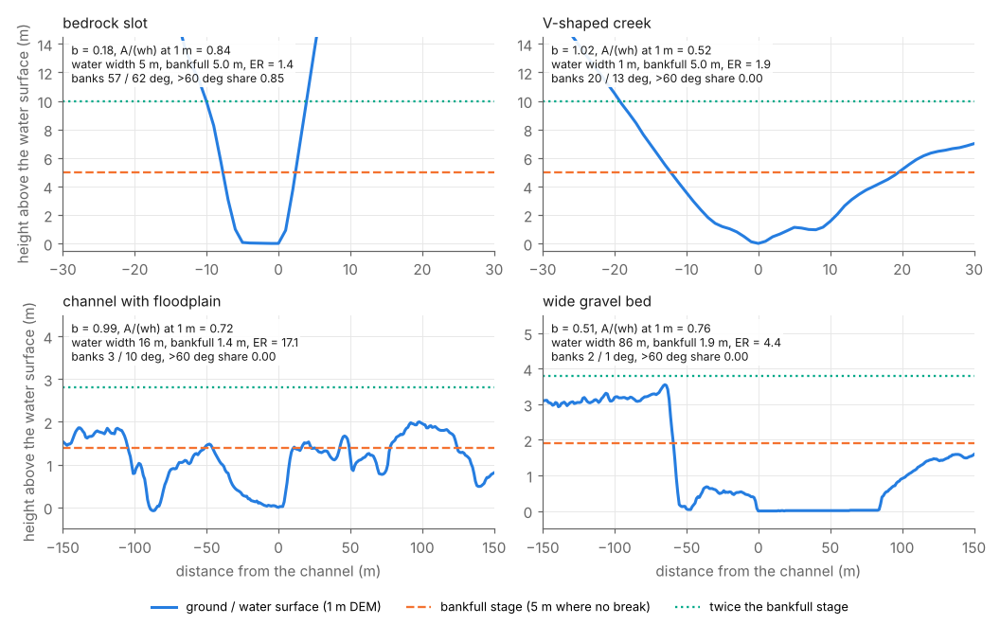

# Cross-sections on the 1 m LiDAR DEM (rf-lxa.4)

The question: which cross-section features should the national 1 m rebuild (epic rf-lxa) compute, and which raw
section data must it store so that other features can be added later without a rerun (the spec goes to rf-lxa.3)?
The candidates were the flood hydraulics of rf-zmy.10 (`xs_vel`, `xs_omega_q`) and a set of channel-shape features.
This page measures them on 1 m sections of the 14 sample tiles of rf-zmy.10 and tests each with the protocol of
[`cross-sections.md`](cross-sections.md).

Code: `src/river_finder/xsec1m.py` (sampler, measures, storage encoding), `xsec1mstudy.py` (check, study, storage
sizes), `xsec1mfig.py` (the figure); tests in `tests/test_xsec1m.py`. Outputs (gitignored):
`data/analysis/lidar-xsec/` (`tiles/<tile>_sec.parquet` one row per section, `tiles/<tile>_reach.pkl` one row per reach,
`reach1m.pkl`, `check_s1.json`, `study.json`, `select_*.json`, `spacing.json`, `storage.json`, `tables.md`).

## Summary

- **Sample**: 876,654 sections every 25 m on 93,102 LiDAR-covered reaches of 2 km² or more in the 14 tiles (86 % of
  the sections kept after re-centring). 92,582 reaches have a kept section: 5,389 positive reaches on 103 guide
  rivers (39 % of the national positives). The two Otago tiles are mostly without LiDAR (19 % and 18 % of their
  reaches). 42 G cells of the 1 m mosaic were read in 20 min, with a peak of 5.6 GB.
- **Flood hydraulics**: on 1 m the Manning flood stage is measured, not guessed. Its median is 1.0 m (p10 0.4 m,
  p90 3.2 m); 0.8 % sit at the 0.1 m floor, against 14 % at the floor on the 8 m DEM. But the velocity is still 91 %
  explained by the flood and the gradient, the stream power is rank-identical to the velocity (ρ = 1.00), and the
  estimated under-water area changes no rank (ρ = 1.00). Beyond the kept channel features, the velocity adds
  -0.0004 style-matched AUC to LightGBM (7 of 10 repeats) and makes the logistic model worse. **Compute `x1_vel`
  (from the stored median stage table, after the national merge) for display and the registry; do not put it in a
  recipe. Drop `x1_omega_q`: it duplicates `x1_vel`.**
- **Channel shape adds information**. Kept, after a backward elimination by group on top of the terrain features and
  the 1 m valley features:
  - **shape**: the shape exponent `x1_b` (w ~ h^b) and the form factor at bankfull `x1_ffbf`;
  - **banks**: the bank angle to bankfull `x1_bank` and the share of the bank in steps steeper than 60° `x1_steep`;
  - **bed roughness** from the 1 m long profile: `x1_rough` (spread around the reach's straight line) and
    `x1_dropconc` (share of the drop in the steepest 10 %);
  - **valley** (the 10-20 m stages from the 2 m DEM, replacing today's 8 m `xs_*`): `x1_w10`, `x1_w20`, `x1_wall`,
    `x1_vf`.
- **Gains** (10 repeats, same folds): terrain + valley + channel against `gbm_terrain` **+0.0086 style-matched AUC
  (10/10)**, +0.022 style x size; against today's 8 m sections `gbm_xsec` +0.0024 (10/10); the channel features alone
  on top of the valley +0.0032 (10/10). Logistic: +0.0110, +0.0031 and +0.0015 (all 10/10). Leave one region out:
  mean style-matched AUC 0.874 -> 0.886 (better in 10 of 11 regions), and better than `gbm_xsec` in 7 of 11.
- **Not kept** (no gain beyond the kept set, or rank duplicates): width-to-depth, hydraulic radius, water width,
  bankfull stage, width and break share, entrenchment ratio, asymmetry, along-reach variability and pinch points. They
  stay computable from the stored profiles.
- **Store the raw profiles** (rf-lxa.3): per section 651 heights above the channel (1 m within ±150 m, 2 m to ±500 m),
  int16 cm as outward differences, plus the channel point, normal, height and flags; one Arrow IPC file per tile.
  About 620 bytes per section: 4.4 GB for every reach of 1 km² or more under LiDAR at 25 m spacing (2.2 GB at 50 m).
  Extraction ~20-25 s per 32 km tile, ~70-85 min for the country.

## Method

### Where the sections come from

This study uses today's national 8 m reach lines (key `gid`), so every reach joins the ML table directly. These lines
lie 11 m (median) / 70 m (p90) from the 1 m channel (rf-lxa.2), so every section is first moved onto the 1 m channel.
The rebuild will cast its sections on 2 m-routed lines, which lie 0.7 m / 4.4 m from the 1 m channel; there the same
code runs with a 10 m search window and the re-centring hardly matters.

- **Stations** every 25 m along each reach of 2 km² or more under LiDAR (at least half of the line), perpendicular to
  the chord from 40 m above to 40 m below the station (`xsec.stations`).
- **Pass 1, find the channel**: the 1 m DEM is sampled every 1 m along the normal, 100 m to each side of the line. The
  channel is the lowest point (3-sample mean, then the lowest raw sample next to it).
- **Pass 2, fix the direction**: the normal is re-cut perpendicular to the chord between the pass-1 channel points of
  the neighbouring sections (50 m apart, else 25 m), through the pass-1 point, and the channel is found again within
  12 m. This removes the error of an 8 m line that cuts across a bend.
- **Dropped sections** (flags in the section table): `EDGE` (a lower point just beyond the search window: the channel
  is farther away), `TWIN` (a second low within 0.5 m of the lowest, behind a rise of 1.5 m or more: two channels),
  `FAR` (pass 2 did not find the channel within 12 m), `LOW` (the channel height is more than max(2 m, 4 MAD) off a
  line through the reach's other sections: another channel), `NODATA`.
- **Water at the channel point**: flagged when the 1 m cells there are hydro-flattened (`FLATW`) or planar
  interpolated water (`PLANW`), as in rf-lxa.1.

### The stored profile

Each section keeps one profile on a fixed grid, centred on the channel: the 1 m DEM (bilinear) every 1 m within
±150 m, and the 2 m block mean of the 1 m cells every 2 m from 152 m to 500 m on each side (651 samples). Heights
are stored above the channel point `z0`. This is exactly the design of rf-lxa.2 (1 m near the channel, the coarser
routing DEM beyond), with the 2 m DEM of the rebuild in place of the 5 m one. **Every section measure below is
computed from this profile alone** (`xsec1m.measure`), so a store of these profiles can recompute every feature, and
add new ones, without reading the LiDAR again.

### Section measures

From the profile, on each side, walk out from the channel until the ground first rises above the stage `h`. Width
`w(h)` is the sum of the two distances, `A(h)` the area under the level, `P(h)` the wetted ground length (as
[`cross-sections.md`](cross-sections.md)). Stages: 0.1, 0.25, 0.5, 0.75, 1, 1.5, 2, 2.5, 3, 4, 5 m (1 m part) and
7.5, 10, 15, 20 m (reaching into the 2 m part), plus every 0.1 m up to 5 m for the fits. No-data samples count as
water at `z0`. From these:

- **Shape exponent** `b` of `w ~ h^b` and `m` of `A ~ h^m` (least squares in log-log over 0.2-2 m): b = 1 for a V,
  0.5 for a parabola, 0 for a box or slot.
- **Form factor** `A / (w h)` at 1 m and at bankfull: 0.5 V, 0.67 parabola, 1 box.
- **Bankfull stage** (Wolman): the stage of the minimum of `w(h) / h` over 0.3-5 m, counted as a break only where the
  ratio later rises 20 % above that minimum (the width jumps as the water leaves the channel). Without a break the
  bankfull stage is set to 5 m. Bankfull width, area, perimeter; width / depth and hydraulic radius `A / P` there.
- **Entrenchment ratio** (Rosgen): width at twice the bankfull stage / bankfull width (w(10) / w(5) without a break).
- **Banks**: the angle of each bank from the 0.25 m water edge to the bankfull stage (1-3 m), and the share of the bank
  rise between 0.25 and 5 m in 1 m steps steeper than 60° (bedrock walls).
- **Asymmetry**: |left - right| bank angle, and |left - right| / width at the 2 m stage.
- **Valley**: widths at 10 and 20 m, the highest ground within 50, 150 and 500 m of each side, and the valley floor
  width-to-height ratio `2 w(2 m) / (left + right highest ground within 500 m)` (after Bull and McFadden's Vf).

Per reach: the median of its kept sections (and the minimum width per stage), and along the reach the coefficient of
variation of the 1 m-stage width and of the bankfull stage, the share of pinch points (sections narrower than half
the median width at 1 m) and the constriction index (narrowest / median width at 1 m). **Bed roughness** comes from
the 1 m long profile through the reach's channel points (every 1 m, the lowest cell within 2 m): the robust spread of
the profile around its straight-line fit, and the share of the reach's drop in its steepest 10 % (running minimum).

The flood hydraulics are computed after the join, because they read the mean annual flood (MAF, with the correction
on) and the gradient: the Manning stage on the reach's median section (`Q = A R^(2/3) S^(1/2) / n`, n = 0.045,
stage floor 0.1 m), then `V = Q / A` (`x1_vel`) and `ω = ρ g Q S / w` (`x1_omega_q`).

### What LiDAR cannot see

LiDAR does not see below the water. Every stage here is a height above the **water surface at capture**, and every
area is the area above it. Wide rivers are often hydro-flattened or interpolated (rf-lxa.1); the water surface then
shows as a flat bottom, which pulls the shape exponent towards 0 (box-like) and the form factor towards 1. The
capture flow is not known per reach (the surveys took up to five years). `x1_*_est` adds an **estimated** under-water
rectangle to every stage: the water width (width at 0.1 m, at least 1 m) times the Manning depth of a capture flow of
5 % of the MAF. That fraction is an assumption, not a measurement; it is there to test whether the missing area
changes the result.



*Four kept sections of tile x05y07 (West Coast), heights above the water surface, with the bankfull stage and twice
that stage. Vertical scales differ between panels.*

## Sample

The 14 tiles of rf-zmy.10 (11 guide regions), reaches of 2 km² or more with at least half the line under LiDAR
(`data/analysis/lidar/reach_coverage.pkl`). "With 1 m": reaches with at least one kept section.

| tile | region | domain reaches | with 1 m | positives with 1 m |
|---|---|---:|---:|---:|
| x02y04 | Otago | 8,118 | 1,538 (19 %) | 191 |
| x02y05 | West Coast | 6,271 | 3,864 (62 %) | 442 |
| x03y05 | Otago | 7,768 | 1,421 (18 %) | 136 |
| x04y06 | Canterbury | 7,981 | 7,505 | 305 |
| x05y07 | West Coast | 7,804 | 7,732 | 636 |
| x06y08 | West Coast | 8,508 | 8,435 | 431 |
| x07y09 | Tasman | 7,976 | 7,942 | 488 |
| x07y10 | Tasman | 8,536 | 8,514 | 598 |
| x07y11 | Tasman | 6,461 | 6,453 | 459 |
| x09y20 | Northland | 8,623 | 8,584 | 183 |
| x11y11 | Wellington | 9,126 | 7,733 (85 %) | 435 |
| x11y14 | Wanganui | 10,459 | 9,262 (89 %) | 596 |
| x12y16 | Bay of Plenty | 11,023 | 10,739 | 417 |
| x12y17 | Waikato | 2,870 | 2,860 | 72 |
| **total** | | **111,524** | **92,582** | **5,389** (of 6,020 in the tiles; 103 rivers) |

Sections dropped (all tiles): 5.8 % `EDGE`, 6.5 % `TWIN`, 4.6 % `FAR`, 0.1 % `LOW`; 13.8 % in all (some carry two
flags). Of the kept sections, 4.5 % sit on hydro-flattened and 3.3 % on planar water. A reach has a median of 9 kept
sections; 90,134 have three or more. The median distance from the 8 m line to the 1 m channel is 18.5 m.

## Check: re-centring against the 1 m channel

On the rf-lxa.2 benchmark sub-area (Hokitika / Toaroha / Kokatahi, 651 reaches, 6,140 sections), the channel points
against the 1 m-routed channel (`s1`, the nearest line of 0.5-2x the reach's area):

| sections | share | distance p50 m | p90 m | within 5 m | within 10 m | 8 m line to channel p50 / p90 m |
|---|---:|---:|---:|---:|---:|---|
| kept | 90.6 % | 1.5 | 27 | 72 % | 83 % | 12 / 52 |
| kept, 2-10 km² | 45.4 % | 1.0 | 36 | 78 % | 85 % | 11 / 47 |
| kept, 10-100 km² | 34.0 % | 1.6 | 11 | 75 % | 89 % | 11 / 38 |
| kept, 100 km² or more | 11.2 % | 7.9 | - | 42 % | 55 % | 24 / 87 |
| dropped (edge, twin, far) | 9.4 % | 24 | - | 30 % | 37 % | 48 / 100 |

The flags remove mostly misplaced sections (30 % of the dropped ones are within 5 m of the channel, against 72 % of
the kept ones). On the big gravel beds the lowest point is often another braid than the 1 m D8 path, in the same bed.
Of the kept sections more than 10 m off (13 % of those under 100 km²), a third have no 1 m channel of similar area
nearby (the 8 m and 1 m catchments differ there); the others mostly found a spot lower than the D8 channel next to it
(median 0.4 m: a side channel or a pool), and 8 % had the channel beyond the ±100 m window.

What this does to the features: sections cast along the 1 m lines themselves (search ±10 m, as for the 2 m lines of
the rebuild) were paired with the re-centred ones (84 % of the kept ones have a twin within 15 m). Rank agreement per
reach (568 reaches with three or more pairs): widths at 1 m 0.95, water width 0.89, shape exponent 0.87, form factor
at 1 m 0.83, bankfull stage 0.80, bankfull width 0.93, entrenchment 0.91, bank angle 0.94, steep share 0.87, 10 m
width 0.99, wall 0.98, Vf 0.97; but width asymmetry 0.38, width variability 0.68 and pinch share 0.46. The re-centred
8 m lines therefore measure the shape features nearly as well as the rebuild will; asymmetry and the along-reach
variability are noisy here and may do better on the 2 m lines.

## Results

### Each feature alone

AUC of positives against background (pooled, within style, within style x size; below 0.5 means low values are the
runs), Spearman with existing features over the sample, the share of the feature's variance a linear fit on the
`gbm_terrain` numeric inputs explains, and the residual's AUC within style (after the terrain inputs; after the
terrain inputs and the 8 m `xs_*` features).

| feature | group | AUC | style | style x size | ρ gorge | ρ MAF | ρ gradient | ρ 8 m `xs_w10` | R² on terrain | residual AUC, style | after 8 m too |
|---|---|---:|---:|---:|---:|---:|---:|---:|---:|---:|---:|
| `x1_vel` | hyd | 0.580 | 0.702 | 0.586 | 0.74 | 0.25 | 0.86 | -0.69 | 0.91 | 0.517 | 0.483 |
| `x1_omega_q` | hyd | 0.542 | 0.647 | 0.568 | 0.74 | 0.18 | 0.90 | -0.69 | 0.94 | 0.529 | 0.510 |
| `x1_vel_est` | hyd_est | 0.579 | 0.702 | 0.585 | 0.74 | 0.25 | 0.87 | -0.68 | 0.91 | 0.515 | 0.481 |
| `x1_b` | shape | 0.264 | 0.275 | 0.346 | -0.39 | -0.24 | -0.10 | 0.41 | 0.23 | 0.382 | 0.399 |
| `x1_ff1` | shape | 0.750 | 0.728 | 0.624 | 0.01 | 0.36 | -0.18 | -0.01 | 0.13 | 0.597 | 0.605 |
| `x1_ffbf` | shape | 0.777 | 0.758 | 0.646 | 0.11 | 0.42 | -0.12 | -0.10 | 0.19 | 0.627 | 0.634 |
| `x1_wd` | wd | 0.621 | 0.593 | 0.466 | -0.55 | 0.25 | -0.47 | 0.64 | 0.43 | 0.483 | 0.517 |
| `x1_rbf` | wd | 0.702 | 0.699 | 0.653 | 0.46 | 0.15 | 0.21 | -0.48 | 0.27 | 0.608 | 0.598 |
| `x1_w1` | wd | 0.703 | 0.672 | 0.539 | -0.45 | 0.34 | -0.45 | 0.52 | 0.37 | 0.527 | 0.571 |
| `x1_w0` | wd | 0.803 | 0.781 | 0.644 | -0.22 | 0.50 | -0.37 | 0.28 | 0.31 | 0.619 | 0.630 |
| `x1_hb` | bankfull | 0.594 | 0.601 | 0.612 | 0.57 | 0.01 | 0.36 | -0.62 | 0.36 | 0.598 | 0.582 |
| `x1_wbf` | bankfull | 0.736 | 0.713 | 0.611 | 0.04 | 0.31 | -0.09 | -0.00 | 0.11 | 0.591 | 0.598 |
| `x1_brk` | bankfull | 0.389 | 0.385 | 0.379 | -0.54 | 0.00 | -0.32 | 0.60 | 0.36 | 0.398 | 0.410 |
| `x1_er` | entrench | 0.356 | 0.346 | 0.355 | -0.57 | -0.05 | -0.34 | 0.62 | 0.33 | 0.388 | 0.399 |
| `x1_bank` | banks | 0.490 | 0.510 | 0.572 | 0.45 | -0.09 | 0.28 | -0.52 | 0.20 | 0.568 | 0.560 |
| `x1_bank_hi` | banks | 0.518 | 0.534 | 0.579 | 0.45 | -0.05 | 0.27 | -0.51 | 0.18 | 0.570 | 0.563 |
| `x1_steep` | banks | 0.537 | 0.543 | 0.539 | 0.25 | 0.07 | 0.16 | -0.29 | 0.10 | 0.445 | 0.450 |
| `x1_asym_ang` | asym | 0.606 | 0.609 | 0.584 | 0.39 | 0.11 | 0.23 | -0.40 | 0.04 | 0.553 | 0.549 |
| `x1_asym_w` | asym | 0.612 | 0.603 | 0.532 | -0.14 | 0.19 | -0.16 | 0.19 | 0.09 | 0.526 | 0.533 |
| `x1_w1_cv` | var | 0.364 | 0.375 | 0.415 | -0.21 | -0.12 | -0.02 | 0.23 | 0.09 | 0.462 | 0.483 |
| `x1_hb_cv` | var | 0.349 | 0.354 | 0.381 | -0.36 | -0.13 | -0.14 | 0.43 | 0.19 | 0.431 | 0.450 |
| `x1_pinchf` | var | 0.458 | 0.461 | 0.457 | -0.18 | -0.01 | -0.06 | 0.19 | 0.06 | 0.491 | 0.517 |
| `x1_pinch` | var | 0.589 | 0.578 | 0.550 | 0.03 | 0.08 | -0.08 | -0.03 | 0.04 | 0.530 | 0.507 |
| `x1_rough` | rough | 0.359 | 0.379 | 0.445 | 0.31 | -0.14 | 0.51 | -0.31 | 0.32 | 0.503 | 0.505 |
| `x1_dropconc` | rough | 0.472 | 0.494 | 0.491 | -0.20 | -0.10 | -0.23 | 0.16 | 0.20 | 0.520 | 0.517 |
| `x1_w10` | valley | 0.478 | 0.450 | 0.379 | -0.80 | 0.10 | -0.58 | 0.89 | 0.67 | 0.390 | 0.409 |
| `x1_w20` | valley | 0.446 | 0.422 | 0.377 | -0.86 | 0.03 | -0.58 | 0.94 | 0.74 | 0.408 | 0.438 |
| `x1_wall` | valley | 0.549 | 0.571 | 0.619 | 0.86 | -0.04 | 0.60 | -0.90 | 0.75 | 0.556 | 0.578 |
| `x1_vf` | valley | 0.523 | 0.502 | 0.439 | -0.87 | 0.04 | -0.67 | 0.87 | 0.66 | 0.420 | 0.473 |
| *for reference:* `gorge` | | 0.549 | 0.564 | 0.578 | | | | | | | |
| `confine` | | 0.256 | 0.217 | 0.392 | | | | | | | |
| `xs_w10` (8 m) | | 0.461 | 0.436 | 0.391 | | | | | | | |
| `xs_wall` (8 m) | | 0.551 | 0.570 | 0.603 | | | | | | | |
| `xs_vel` (8 m) | | 0.595 | 0.718 | 0.602 | | | | | | | |

- The **valley** features repeat the 8 m sections (ρ 0.87-0.94 with them; 75 % of their variance is terrain).
- The **channel** features are new: their correlation with the 8 m sections and with gorge depth is 0.0-0.6, and the
  terrain explains only 4-43 % of them. The strongest left-overs (residual AUC within style 0.60-0.63, or 0.38-0.40
  for those where low values are the runs): the form factor at bankfull (box-like sections are the runs), the water
  width at capture, the hydraulic radius at bankfull, the shape exponent (low b = box-like), the entrenchment ratio
  and the share with a bankfull break (low = entrenched).
- The **flood velocity** separates well alone (0.70 within style) but only because of the flood and the gradient: after
  the terrain inputs its residual is at 0.52, and below 0.5 after the 8 m sections.

### Each group on top of the terrain recipes (CV, paired)

`ml.run_cv` on the sample: 5-fold outlet-catchment folds, 10 repeats, every model on the same folds and background
sample, so the differences are paired (± = sd over repeats, (k/10) = repeats where the model with the group is
better). Base: `gbm_terrain` (style-matched AUC 0.8945) and `logit_plus` (0.8988).

| group (features) | LightGBM: style-matched gain | style x size | logistic: style-matched gain | style x size |
|---|---:|---:|---:|---:|
| 8 m sections (`gbm_xsec` / `logit_xsec`) | +0.0063 ± 0.0019 (10/10) | +0.0166 (10/10) | +0.0080 ± 0.0009 (10/10) | +0.0258 (10/10) |
| hyd (vel, omega_q) | +0.0014 ± 0.0015 (7/10) | +0.0045 (10/10) | +0.0050 ± 0.0006 (10/10) | +0.0182 (10/10) |
| hyd_est (the same with the under-water estimate) | +0.0014 ± 0.0010 (9/10) | +0.0045 (9/10) | +0.0045 ± 0.0006 (10/10) | +0.0168 (10/10) |
| shape (b, ff1, ffbf) | +0.0021 ± 0.0015 (9/10) | +0.0049 (8/10) | +0.0049 ± 0.0007 (10/10) | +0.0182 (10/10) |
| wd (wd, rbf, w1, w0) | +0.0022 ± 0.0017 (9/10) | +0.0059 (9/10) | +0.0047 ± 0.0007 (10/10) | +0.0167 (10/10) |
| bankfull (hb, wbf, brk) | +0.0014 ± 0.0015 (7/10) | +0.0036 (7/10) | +0.0036 ± 0.0005 (10/10) | +0.0131 (10/10) |
| entrench (er) | +0.0014 ± 0.0014 (8/10) | +0.0038 (8/10) | +0.0045 ± 0.0005 (10/10) | +0.0153 (10/10) |
| banks (bank, bank_hi, steep) | +0.0023 ± 0.0012 (10/10) | +0.0059 (10/10) | +0.0000 ± 0.0003 (4/10) | +0.0010 (9/10) |
| asym (asym_ang, asym_w) | +0.0009 ± 0.0011 (7/10) | +0.0026 (7/10) | +0.0003 ± 0.0001 (10/10) | +0.0012 (10/10) |
| var (w1_cv, hb_cv, pinchf, pinch) | +0.0016 ± 0.0012 (9/10) | +0.0039 (9/10) | +0.0027 ± 0.0003 (10/10) | +0.0088 (10/10) |
| rough (rough, dropconc) | +0.0016 ± 0.0010 (9/10) | +0.0038 (9/10) | -0.0005 ± 0.0003 (0/10) | -0.0015 (0/10) |
| valley (w10, w20, wall, vf) | +0.0054 ± 0.0016 (10/10) | +0.0155 (10/10) | +0.0095 ± 0.0010 (10/10) | +0.0324 (10/10) |
| all 30 1 m features | +0.0101 ± 0.0016 (10/10) | +0.0242 (10/10) | +0.0099 ± 0.0010 (10/10) | +0.0324 (10/10) |

Every group gains a little alone, but most of them carry the same information (the logistic gains of hyd, shape, wd,
bankfull and entrenchment are each about half of the valley's and do not add up).

### Selection: what is left once the others are in

Backward elimination by group (`xsec1mstudy.select`), on top of `gbm_terrain` + valley (0.8999) and `logit_plus` +
valley (0.9083), with one or two features per concept (rank duplicates dropped first: `x1_omega_q` ~ `x1_vel` 1.00,
`_est` ~ measured 1.00, `x1_bank_hi` ~ `x1_bank` 0.97, `x1_rbf` ~ `x1_hb` 0.91, `x1_w1` ~ `x1_wd` 0.90, `x1_brk` ~
`x1_hb` -0.87, `x1_pinchf` ~ `x1_pinch` -0.79). The table shows the change when one group is removed from the full
model (negative = the group adds information; (k/10) = repeats where the model without it is better).

| removed group | round 1, LightGBM | round 1, logistic | round 2, LightGBM | round 2, logistic |
|---|---:|---:|---:|---:|
| none: full model - base (k = full better) | +0.0042 (10/10) | +0.0006 (9/10) | +0.0035 (10/10) | +0.0010 (10/10) |
| hyd (vel) | -0.0008 (3/10) | +0.0004 (10/10) | -0.0004 (3/10) | +0.0005 (10/10) |
| shape (b, ffbf) | -0.0006 (4/10) | +0.0002 (8/10) | **-0.0010 (2/10)** | **-0.0008 (0/10)** |
| banks (bank, steep) | **-0.0011 (1/10)** | **-0.0012 (0/10)** | **-0.0008 (4/10)** | **-0.0016 (0/10)** |
| rough (rough, dropconc) | -0.0007 (4/10) | -0.0004 (0/10) | **-0.0009 (4/10)** | -0.0000 (5/10) |
| size (w0, wd) | +0.0000 (5/10) | +0.0001 (6/10) | | |
| bankfull (hb, er) | +0.0000 (4/10) | +0.0002 (10/10) | | |
| asym (asym_ang) | -0.0001 (4/10) | -0.0000 (3/10) | | |
| var (w1_cv, hb_cv, pinch) | -0.0005 (5/10) | +0.0001 (7/10) | | |

Round 1 dropped size, bankfull, asymmetry and variability (no loss when removed). Round 2 kept shape, banks and
roughness and dropped the velocity: it helps LightGBM by 0.0004 and makes the logistic model worse in every repeat.

### Final models

| model | AUC | style-matched | style x size | recall top 10 % |
|---|---:|---:|---:|---:|
| `gbm_terrain` | 0.9101 | 0.8945 ± 0.0046 | 0.7427 | 0.707 |
| `gbm_xsec` (8 m sections, today) | 0.9155 | 0.9008 ± 0.0041 | 0.7592 | 0.734 |
| `gbm_t+valley` | 0.9147 | 0.8999 ± 0.0047 | 0.7581 | 0.732 |
| **`gbm_t+keep`** (valley + shape + banks + roughness) | **0.9176** | **0.9031** ± 0.0045 | **0.7644** | **0.746** |
| `gbm_xsec+low` (8 m sections + shape + banks + roughness) | 0.9180 | 0.9034 ± 0.0046 | 0.7652 | 0.745 |
| `gbm_t+x1all` (all 30) | 0.9191 | 0.9046 ± 0.0042 | 0.7668 | 0.752 |
| `logit_plus` | 0.9157 | 0.8988 ± 0.0026 | 0.7400 | 0.750 |
| `logit_xsec` | 0.9218 | 0.9067 ± 0.0026 | 0.7658 | 0.768 |
| **`logit_t+keep`** | **0.9239** | **0.9098** ± 0.0028 | **0.7756** | **0.779** |
| `logit_t+x1all` | 0.9228 | 0.9087 ± 0.0029 | 0.7724 | 0.772 |

Paired gains (same folds and seeds):

| model | against | AUC | style-matched | style x size | recall top 10 % |
|---|---|---:|---:|---:|---:|
| `gbm_t+valley` | `gbm_xsec` | -0.0008 (4/10) | -0.0008 ± 0.0017 (4/10) | -0.0011 (4/10) | -0.002 (6/10) |
| `gbm_t+keep` | `gbm_terrain` | +0.0075 (10/10) | **+0.0086 ± 0.0020 (10/10)** | +0.0217 (10/10) | +0.039 (10/10) |
| `gbm_t+keep` | `gbm_xsec` | +0.0021 (10/10) | **+0.0024 ± 0.0016 (10/10)** | +0.0052 (10/10) | +0.012 (10/10) |
| `gbm_t+keep` | `gbm_t+valley` | +0.0029 (10/10) | **+0.0032 ± 0.0014 (10/10)** | +0.0063 (9/10) | +0.014 (10/10) |
| `gbm_xsec+low` | `gbm_xsec` | +0.0025 (10/10) | +0.0027 ± 0.0017 (10/10) | +0.0060 (10/10) | +0.011 (10/10) |
| `gbm_t+x1all` | `gbm_t+keep` | +0.0015 (8/10) | +0.0015 ± 0.0014 (7/10) | +0.0024 (7/10) | +0.006 (8/10) |
| `logit_t+keep` | `logit_plus` | +0.0082 (10/10) | +0.0110 ± 0.0009 (10/10) | +0.0356 (10/10) | +0.029 (10/10) |
| `logit_t+keep` | `logit_xsec` | +0.0021 (10/10) | +0.0031 ± 0.0006 (10/10) | +0.0098 (10/10) | +0.011 (10/10) |
| `logit_t+keep` | `logit_t+valley` | +0.0011 (10/10) | +0.0015 ± 0.0003 (10/10) | +0.0032 (10/10) | +0.008 (10/10) |
| `logit_t+x1all` | `logit_t+keep` | -0.0010 (0/10) | -0.0011 ± 0.0003 (0/10) | -0.0032 (0/10) | -0.007 (0/10) |

LightGBM's gain in `gbm_t+keep`: `x1_ffbf` 0.030 (sixth of all inputs, after MAF, Melton, plateau, hard rock and
head), `x1_w10` 0.024, `x1_b` 0.021, `x1_w20` 0.021, `x1_vf` 0.015, `x1_wall` 0.014, `x1_dropconc` 0.009, `x1_bank`
0.008, `x1_rough` 0.007, `x1_steep` 0.001; together 0.15.

Leave one region out (style-matched AUC; train on the other regions' catchments of the sample):

| region | positives | `gbm_terrain` | `gbm_xsec` | `gbm_t+valley` | `gbm_t+keep` | `gbm_xsec+low` | `logit_plus` | `logit_xsec` | `logit_t+keep` |
|---|---:|---:|---:|---:|---:|---:|---:|---:|---:|
| Bay of Plenty | 428 | 0.869 | 0.875 | 0.875 | 0.870 | 0.871 | 0.908 | 0.910 | 0.919 |
| Canterbury | 249 | 0.696 | 0.718 | 0.698 | 0.715 | 0.691 | 0.708 | 0.713 | 0.707 |
| Manawatu | 19 | 0.975 | 0.985 | 0.988 | 0.991 | 0.988 | 0.940 | 0.927 | 0.966 |
| Northland | 183 | 0.946 | 0.953 | 0.950 | 0.945 | 0.950 | 0.925 | 0.921 | 0.930 |
| Otago | 37 | 0.985 | 0.990 | 0.993 | 0.991 | 0.992 | 0.955 | 0.982 | 0.980 |
| Southland | 154 | 0.854 | 0.860 | 0.857 | 0.860 | 0.874 | 0.903 | 0.905 | 0.901 |
| Tasman | 963 | 0.866 | 0.868 | 0.876 | 0.882 | 0.887 | 0.902 | 0.908 | 0.913 |
| Waikato | 125 | 0.871 | 0.882 | 0.891 | 0.886 | 0.896 | 0.879 | 0.894 | 0.900 |
| Wanganui | 532 | 0.874 | 0.877 | 0.879 | 0.893 | 0.883 | 0.912 | 0.924 | 0.918 |
| Wellington | 416 | 0.871 | 0.877 | 0.876 | 0.884 | 0.889 | 0.914 | 0.931 | 0.934 |
| West Coast | 2,283 | 0.808 | 0.825 | 0.829 | 0.832 | 0.833 | 0.862 | 0.873 | 0.876 |
| **mean** | | **0.874** | **0.883** | **0.883** | **0.886** | **0.887** | **0.892** | **0.899** | **0.904** |
| mean, style x size | | 0.700 | 0.724 | 0.719 | 0.730 | 0.729 | 0.685 | 0.707 | 0.738 |

`gbm_t+keep` is better than `gbm_terrain` in 10 of 11 regions and than `gbm_xsec` in 7; `logit_t+keep` than
`logit_plus` in 9 and than `logit_xsec` in 7.

### Spacing: 25 m or 50 m

Every other section (50 m) against every section (25 m), same reaches: rank agreement of the kept features 0.99
(valley), 0.999 (roughness, which reads the long profile), 0.96 (bank angle), 0.94 (shape exponent), 0.90 (form
factor at bankfull), 0.83 (steep share). The CV gain of `gbm_t+keep` over `gbm_terrain` falls from +0.0086 to
+0.0075, of the logistic model from +0.0110 to +0.0104 (`spacing.json`). 25 m keeps about an eighth more of the gain
for twice the storage.

### Resolution and the flood hydraulics

1 m against the 8 m sections on the same reaches (Spearman; partial = after a linear fit on log MAF and log gradient,
which both share; median values):

| measure | ρ | partial ρ | median 1 m | median 8 m |
|---|---:|---:|---:|---:|
| width at 1 m | 0.56 | 0.46 | 15 m | 48 m |
| width at 2 m | 0.69 | 0.61 | 27 m | 77 m |
| width at 5 m | 0.83 | 0.77 | 65 m | 133 m |
| width at 10 m | 0.89 | 0.85 | 125 m | 203 m |
| width at 20 m | 0.93 | 0.90 | 245 m | 334 m |
| lower wall within 150 m | 0.93 | 0.90 | 18.3 m | 14.2 m |
| Manning flood stage | 0.61 | 0.30 | 1.01 m | 0.89 m |
| flood velocity | 0.95 | 0.72 | 2.3 m/s | 1.6 m/s |
| flood unit stream power | 0.97 | 0.80 | 297 W/m² | 121 W/m² |

- The 8 m DEM is 1.1-1.9x too wide (more at the low stages) and its 1-2 m stages rank poorly; from 10 m up it ranks
  reaches as LiDAR does, which is why `gbm_t+valley` and `gbm_xsec` are equal.
- The 1 m flood stage: median 1.0 m, p10 0.41 m, p90 3.2 m, 2.6 m for 50 km² and more; 0.8 % at the 0.1 m floor, 4.6 %
  above 5 m (into the 2 m part). On 8 m, 14 % sit at its 0.25 m floor.
- A linear fit on log MAF and log gradient explains 91 % of the log 1 m velocity (95 % of the stream power), against 73 %
  on 8 m: the extra 8 m variance was noise, and what the 1 m section adds is small.
- Under-water estimate: median depth 0.26 m at the assumed capture flow; `x1_vel_est` vs `x1_vel` ρ = 1.00. The missing
  area lowers the flood stage a little but changes no ranking, so the caveat matters for absolute velocities, not for
  the model.

## Verdict and keep list

The 1 m sections add information the terrain features and the 8 m sections do not have, and it is about channel shape,
not flood hydraulics. Keep for the rebuild (feature names as in `xsec1mstudy.FEATURES1M`):

| feature | what | why |
|---|---|---|
| `x1_w10`, `x1_w20`, `x1_wall`, `x1_vf` | valley widths at 10 and 20 m, lower wall within 150 m, valley floor width-to-height | replace the 8 m `xs_*` (equal gain, measured the same way everywhere in the rebuild) |
| `x1_b`, `x1_ffbf` | shape exponent (0.2-2 m), form factor at bankfull | largest new information: box-like channels are the runs; -0.0010 / -0.0008 when removed |
| `x1_bank`, `x1_steep` | bank angle to bankfull, share of the bank in >60° steps | bedrock banks; -0.0008 / -0.0016 when removed, both models |
| `x1_rough`, `x1_dropconc` | bed roughness and drop concentration of the 1 m long profile | boulder gardens and steps; -0.0009 for LightGBM |
| `x1_vel` (registry only) | Manning flood velocity on the median section | asked for, cheap (from the stored stage table after the merge), shown to users; not in a recipe |

Candidate recipes for the national CV after the rebuild: `gbm_terrain` + the keep list (`gbm_t+keep` here) and the
logistic `logit_plus` + the keep list. The dropped features need no extra data: the stored profiles give them back.

## Limits

- One sample of 14 tiles (39 % of the positives). With little data `logit_plus` beats `gbm_terrain` here (0.899 vs
  0.895 style-matched), the reverse of the national CV, so the national gains may differ. The background holds
  unknown runs: every AUC is a lower bound.
- The sections sit on re-centred 8 m lines: 72 % of the kept channel points within 5 m of the 1 m channel. The rebuild's
  2 m lines will place sections better, which favours the noisier features (asymmetry, variability) a little.
- LiDAR sees the water surface: stages and areas are above it, and wide hydro-flattened rivers look like boxes. The
  shape features partly measure how much water was visible at capture (`x1_w0`, the water width, correlates 0.50
  with the flood).
- The capture flow is not known per reach; the under-water estimate assumes 5 % of the MAF.
- The bankfull rule (minimum of w/h with a 20 % rise) finds a break in 47 % of the kept sections (median 1.4 m above
  the water); without one the features use 5 m. Other rules can be tried on the stored profiles.
- The long profile here joins the channel points of the sections (25 m apart), so it cuts meander bends in small
  creeks; the rebuild has the 2 m line itself.

## Storage spec for the national pass (rf-lxa.3)

The rebuild routes at 2 m on about 200 tiles of 32 km plus halo, and has the 2 m DEM in memory. It should keep the
**raw section profiles**, not only the features: every feature on this page is computed from the profile alone, and so
is any later one (other stages, other bankfull rules, terraces, bank shape) without reading the LiDAR again.

### Per section: one row in `xsec/<tile>.arrow` (Arrow IPC / Feather v2, zstd level 9)

| column | type | content |
|---|---|---|
| `gid` | int64 | reach id (tile index x 10^6 + local id) |
| `s` | float32 | station, m along the reach line from its upper end |
| `x`, `y` | int32 | channel point (the section's centre), NZTM, cm |
| `nx`, `ny` | float32 | unit normal of the section (negative distances = left bank looking downstream) |
| `z0` | float32 | channel height = water surface at capture, m NZVD2016 |
| `flags` | uint8 | re-centring and water flags (`xsec1m.FLAG_*`: no data, edge, twin, low, far, flattened, planar) |
| `dprof` | int16 x 650 | the profile: heights above `z0` in cm on the fixed grid `xsec1m.U` (1 m within ±150 m, 2 m from 152 to 500 m), stored as differences walking out from the channel, left side first (`xsec1m.encode` / `decode`) |
| `nodata` | uint8 x 82 | the no-data bits of the 651 samples (packed) |

- **Where**: a station every 25 m (recommended; 50 m keeps seven eighths of the gain for half the size, see the spacing
  result) on every reach of 1 km² or more, including those on the 8 m fallback (their profile then comes from the
  fallback 2 m DEM; the reach's `dem_source` says so). In the rebuild the sections are cast on the 2 m lines with a
  10 m search (`extract(..., search=10)`); the flags and the `LOW` check stay.
- **Precision**: 1 cm, clipped at ±327.67 m above the channel (only far wall tops in the Alps reach it). No data
  (sea, lake holes) is a bit, not a value; the measures treat it as water at `z0`.
- **Encoding**: the differences are small, so zstd packs them 1.6x better than the heights; decoding is exact
  (`tests/test_xsec1m.py`). Arrow IPC compresses each column buffer whole and reads back with `pyarrow.feather`
  (Parquet was 10 % larger here).

### Per reach (in the reach table)

The kept features (the keep list above), the median stage table (`w`, `A`, `P` at the 15 stages: the Manning hydraulics need it
after the national merge, when the network areas and the MAF are known), the minimum width per stage, the shares of
dropped sections and of water at the channel, and `x1_n`. The bed roughness reads the reach's **1 m long profile**,
which rf-lxa.2 already stores per reach (every 1 m along the 2 m line, lowest 1 m cell within 2 m); no extra data.

### Size

Measured on the stored profiles of x05y07 and x12y16 (`storage.json`, bytes per section):

| layout | x05y07 | x12y16 |
|---|---:|---:|
| heights, int16 cm, raw | 1,302 | 1,302 |
| heights, zstd | 990 | 879 |
| differences + no-data bits, zstd | 636 | 567 |
| same, 2 m part (152-500 m) at 1 dm | 503 | 441 |
| 1 m part only (±150 m), differences, zstd | 268 | 242 |
| stage table only (15 stages x 2 sides, A and P), zstd | 143 | 141 |
| header columns, zstd | 26 | 25 |
| **recommended layout as an Arrow IPC file** | **655** | **586** |

At about 620 bytes per section (40 per km at 25 m, 20 per km at 50 m), with the reach km of today's network:

| reaches | km under LiDAR | sections every 25 m | every 50 m |
|---|---:|---:|---:|
| 2 km² or more | 125,480 | 3.1 GB | 1.6 GB |
| **1 km² or more** | **176,030** | **4.4 GB** | **2.2 GB** |
| 0.5 km² or more | 232,402 | 5.8 GB | 2.9 GB |

(The 8 m fallback reaches add about 17 % to the 1 km² row.) To halve it: store the 2 m part at 1 dm (-20 %), or sections
every 50 m. A stage table alone (165 B per section) is a quarter of the size but cannot give back the bank angles, the
steep share, the bankfull break on a finer grid, or anything not decided today.

### Cost per tile (2 m routing, ~32 km tiles)

Measured here: 0.32 ms per section for both passes, the stored profile, all measures and the long profile (278 s for
876,654 sections). A 32 km tile holds about 880 km of reaches of 1 km² or more, so ~35,000 sections at 25 m: **~11 s of
extraction**. The 1 m DEM is not kept in memory next to the 2 m one, so the extraction re-reads the 1 m blocks within
~165 m of the 2 m channels (150 m + a 10 m search + margin): 40-70 % of the core's blocks (rf-lxa.2), 0.4-0.7 G cells,
**~8-12 s at 60 M cells/s**, in 8 km chunks (0.3 GB each). The 2 m part of each profile is sampled from the 2 m DEM
in memory. About 20-25 s per tile, **70-85 min for the country**, and no transient disk. (This study read ±625 m
corridors at 1 m because it had no 2 m DEM: 42 G cells for 14 tiles in 20 min, peak 5.6 GB with two 16 km chunks in
memory.)

## Reproduce

```bash
uv run river-finder xsec1m tiles             # the 14 sample tiles (~25 min, peak 5.6 GB; resumable per tile) ->
                                             # data/analysis/lidar-xsec/tiles/, reach1m.pkl; keeps the profiles of
                                             # x05y07 and x12y16 (--keep-profiles)
uv run river-finder xsec1m check             # re-centring against the 1 m channel on the bench sub-area (needs the
                                             # x05y07 run and data/analysis/lidar-bench/variants/s1; ~1 min)
uv run river-finder xsec1m study             # single features, groups, final models, LORO (~16 min) -> study.json,
                                             # tables.md
uv run river-finder xsec1m select            # backward elimination, rounds 1 and 2 (~16 min) -> select_*.json
uv run river-finder xsec1m spacing           # 25 m against 50 m (~5 min) -> spacing.json
uv run river-finder xsec1m storage           # bytes per section for the storage options -> storage.json
uv run river-finder xsec1m figure            # docs/img/cross-sections-1m.png
```

`study`, `select` and `spacing` read the cached ML table (`data/nz/ml_table.pkl`, MAF correction as configured) and the
8 m sample sections of rf-zmy.10 (`data/analysis/xsec/nz.pkl`). Outputs use about 0.7 GB.
