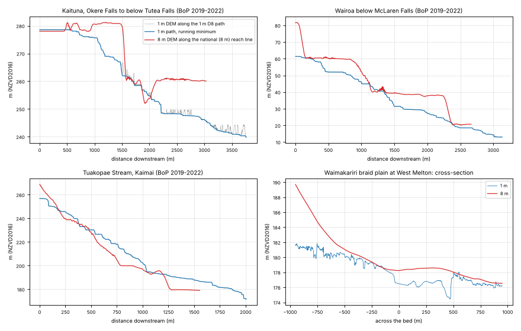
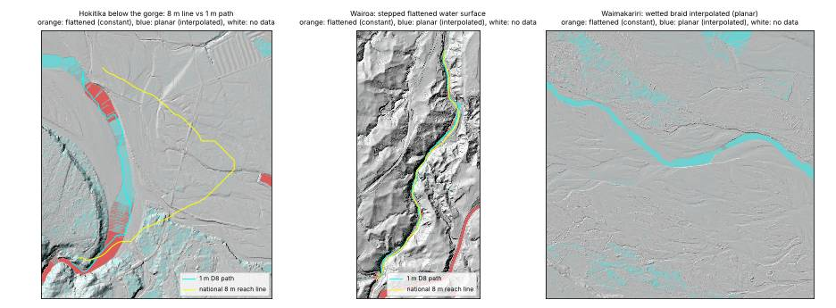

# 1 m LiDAR coverage audit (rf-lxa.1)

Before the national rebuild on the LINZ 1 m LiDAR DEM (epic rf-lxa), this audit answers: where does 1 m LiDAR
exist, from which survey and year, how much of each region, reach, catchment and guide section it covers,
where the gaps are, what the fallback and seam rule should be, and what water looks like in the 1 m DEM.

Code: `src/river_finder/lidar.py`, `river-finder lidar fetch|coverage` (tests: `tests/test_lidar.py`).
Outputs (gitignored, `data/analysis/lidar/`): `lidar_coverage.gpkg` (layers `coverage` and `gaps`),
`reach_coverage.pkl` (one row per national reach, key `gid`), `summary.json`, `stac/` (survey table and
footprints), `water/` (the water-surface samples below). Data as of the STAC on 2026-11-26.

## Summary

- **85 % of NZ has 1 m LiDAR** in the national mosaic (84.8 % of the land the national tiles route; 85.6 % of
  all reach km; 85.5 % of the km of reaches of 2 km2 or more; **88.0 % of the guide-section km**).
- **Twelve of the sixteen guide regions are (almost) fully covered** (97 to 100 % of the land), including all of the West Coast,
  Canterbury, Tasman and Marlborough, so most of the Southern Alps have LiDAR. The gaps are in **Otago (31 %
  covered)**, **Southland (63 %: Fiordland and Stewart Island)**, **Wanganui (73 %: the Rangitikei, Moawhango,
  Hautapu and Turakina headwaters)** and **Manawatu (80 %: the Tararua east side, Mangahao)**, plus the
  interiors of the large lakes.
- **Guide sections**: 337 runnable sections are placed on national reaches; 288 are fully under LiDAR, 16
  partly, 33 not at all. Almost all of the missing ones are Queenstown Lakes and Fiordland runs (Shotover,
  Kawarau, Nevis, Matukituki, Dart area, Hollyford, Wilkin, Young), the Taieri, and the Rangitikei and Mangahao.
- **Capture years**: 2008 to 2026; 61 % of the covered reach km were flown in 2023-2026 and 31 % in 2020-2022.
  Only Wellington (2013-2014) and a few small surveys are older than 2016.
- **Fallback**: the 8 m contour DEM where there is no LiDAR, with an elevation correction feathered across the
  seam (8 m minus LiDAR at the seam: median |offset| 2.8 m, p90 6.3 m, so a hard switch makes steps of
  metres), lake holes filled flat at the LiDAR water level, and a per-reach source flag, survey and year.
- **Water in the 1 m DEM is never a bed**: lakes are flattened to one level (big lake interiors are no data),
  rivers are either flattened in steps (Bay of Plenty) or interpolated as planar triangles (West Coast,
  Canterbury braids). Real falls and rapids show in the long profile (Tutea Falls, the Tuakopae steps), the
  8 m reach lines drift 5 to 250 m off the 1 m channel, and the 8 m DEM puts gorge floors up to ~20 m too high.

## Method

### Coverage layer

The national mosaic `new-zealand/new-zealand/dem_1m/2193` (424 COG items, Topo50 sheets of 24 x 36 km) is built
from 82 of the 109 `dem_1m` survey collections in `s3://nz-elevation`. An item's box is not proof of data: of the
424 sheets, 143 are more than 98 % covered and 25 less than 2 %. The mosaic's `capture-dates.geojson` asset is
the proof: one footprint per survey, the area that survey supplies to the mosaic, nodata excluded, simplified.
The 82 footprints are disjoint (overlap below 0.5 km2) and their union is 233,063 km2.

The footprints were checked against the real data on eleven partly covered sheets (BV16, BS19, CB11, CA11, BZ13,
CD16, BU18, BK35, BY11, BJ35, BD37), reading the 32 m overview: 99.3-99.98 % of valid cells are inside the
footprint and no footprint cell is nodata (BD37: 0.7 %, the coast). So the footprints are the coverage layer.

The 26 survey collections that are not in the mosaic (older surveys replaced by newer ones, and new flights) were
added where they cover ground nothing else does: only 211 km2 in total (Hawke's Bay 2020-2021 147 km2, Tauranga
and coast 2015 46 km2, Marlborough 2026 8 km2, and slivers). They are in the layer with `in_mosaic = False`; no
reach depends on them (largest share on any reach 22 %). Three are *newer* than the mosaic data under them and
may be worth reading later: `marlborough_2026` (draft, flown June-July 2026, 441 km2 over 2017-2022 data),
`hicks-bay_2026` (84 km2 over Gisborne 2023) and `waioweka-gorge_2026` (49 km2, the Waioweka gorge, over Bay of
Plenty 2019-2022).

The STAC has survey name, flight dates, producer, licensor and lifecycle per survey, but **no point density or
vertical accuracy**: those are only in LINZ's survey reports (LINZ Data Service, OpenTopography), not read here.

### Per reach and per catchment

- **Reach line**: each national reach (the tiles' `segments_core.gpkg`, 1,104,794 reaches) is sampled every 25 m;
  each sample takes the footprint that contains it. `lidar_share` is the share of the reach under the mosaic,
  `new_share` under a survey not in it, `lidar_code` the survey over most of the reach.
- **Catchment**: the footprints are rasterised on each tile's 8 m local-catchment grid
  (`local_catchment_core.tif`), cells are counted per local catchment and survey, and accumulated down the
  national network: `catch_lidar_share` is the share of the reach's whole upstream catchment under LiDAR.
- **Guide sections**: `models.all_sections()` placed with `models.map_sections` (as the ML labels are); runnable
  sections only. "Guide km" in the region table counts each reach once and leaves out held-out sections.
- **Gaps**: land without LiDAR counted on a 1 km grid; cells with at least half their land uncovered joined
  into connected gap areas (layer `gaps`).

## Coverage by region

Regions are the guide regions of the national table. "Reaches >= 2 km2" is the scoring and ML domain.

| region | land km2 | land under LiDAR | reach km (all) | under LiDAR | reaches >= 2 km2 | km >= 2 km2 | under LiDAR | whole catchment >= 95 % | guide km | guide under LiDAR | capture 2008-15 / 16-19 / 20-22 / 23-26 (%) |
|---|---:|---:|---:|---:|---:|---:|---:|---:|---:|---:|---|
| Auckland | 4,027 | 100.0 % | 3,982 | 100.0 % | 7,523 | 1,854 | 100.0 % | 100.0 % | 0 | - | 0 / 0 / 0 / 100 |
| Bay of Plenty | 11,880 | 99.5 % | 13,198 | 99.2 % | 29,689 | 7,341 | 99.1 % | 99.0 % | 260 | 100.0 % | 0 / 0 / 93 / 7 |
| Canterbury | 44,318 | 99.3 % | 49,530 | 98.9 % | 109,254 | 26,936 | 98.9 % | 99.5 % | 676 | 100.0 % | 3 / 17 / 0 / 80 |
| Gisborne | 8,189 | 100.0 % | 8,079 | 100.0 % | 18,325 | 4,542 | 100.0 % | 100.0 % | 47 | 100.0 % | 0 / 0 / 0 / 100 |
| Hawke's Bay | 13,902 | 100.0 % | 15,003 | 100.0 % | 33,234 | 8,232 | 100.0 % | 100.0 % | 240 | 100.0 % | 0 / 0 / 0 / 100 |
| Manawatu | 7,622 | 80.5 % | 8,447 | 80.9 % | 18,822 | 4,650 | 80.1 % | 69.8 % | 37 | 44.9 % | 1 / 10 / 1 / 89 |
| Marlborough | 9,717 | 100.0 % | 9,358 | 100.0 % | 20,293 | 5,013 | 100.0 % | 100.0 % | 145 | 100.0 % | 2 / 6 / 92 / 1 |
| Northland | 11,280 | 100.0 % | 11,705 | 100.0 % | 24,098 | 5,961 | 100.0 % | 100.0 % | 49 | 100.0 % | 0 / 0 / 77 / 23 |
| Otago | 31,320 | 30.7 % | 32,420 | 32.8 % | 71,159 | 17,522 | 32.1 % | 24.7 % | 296 | 16.9 % | 0 / 10 / 47 / 43 |
| Southland | 30,205 | 62.8 % | 29,216 | 66.0 % | 63,139 | 15,524 | 66.2 % | 60.1 % | 126 | 56.0 % | 0 / 0 / 0 / 100 |
| Taranaki | 7,067 | 100.0 % | 8,277 | 100.0 % | 18,875 | 4,687 | 100.0 % | 100.0 % | 46 | 100.0 % | 0 / 0 / 100 / 0 |
| Tasman | 9,756 | 100.0 % | 9,555 | 100.0 % | 20,562 | 5,070 | 100.0 % | 100.0 % | 265 | 100.0 % | 0 / 1 / 81 / 18 |
| Waikato | 23,859 | 97.9 % | 26,674 | 97.3 % | 58,473 | 14,463 | 96.9 % | 98.3 % | 100 | 100.0 % | 0 / 0 / 79 / 20 |
| Wanganui | 14,317 | 72.7 % | 15,545 | 72.3 % | 35,092 | 8,692 | 72.3 % | 66.1 % | 262 | 67.4 % | 0 / 4 / 8 / 88 |
| Wellington | 7,815 | 100.0 % | 8,389 | 100.0 % | 18,301 | 4,524 | 100.0 % | 100.0 % | 120 | 100.0 % | 76 / 0 / 0 / 24 |
| West Coast | 22,714 | 100.0 % | 22,064 | 100.0 % | 47,897 | 11,764 | 100.0 % | 99.9 % | 725 | 100.0 % | 0 / 0 / 0 / 100 |
| **New Zealand** | 257,985 | 84.8 % | 271,443 | 85.6 % | 594,736 | 146,773 | 85.5 % | 83.5 % | 3,395 | 88.0 % | 3 / 5 / 31 / 61 |

Per-reach source class (`source_flag`, share of the reach line under LiDAR): 944,408 reaches `lidar` (>= 95 %),
2,245 `mixed` (a seam crosses them), 158,141 `8m` (< 5 %). In Waikato and Bay of Plenty the missing 0.5-2 % are the
interiors of Lake Taupo and Lake Rotorua, in Canterbury the lakes Te Waihora, Pukaki, Ohau and Benmore. The three
reference areas (kaimai, karangahake, tutamoe) are 100 % LiDAR (`source_fraction_fine = 1.0` on their 5 m DEMs).

## Capture years and surveys

Year the flight ended, km of reaches >= 2 km2 under it: 2010: 104, 2013: 165, 2014: 3,913, 2015: 46, 2016:
1,074, 2017: 1,300, 2018: 383, 2019: 3,400, 2020: 4,645, 2021: 18,758, 2022: 15,725, 2023: 10,042, **2024:
38,664**, **2025: 25,797**, 2026: 1,463. The regional surveys took up to five years (Canterbury 2020-2025, West Coast
2020-2024), so a reach's year is its survey's end year; the start year is kept too. Guide sections by the latest
year under them: 2024 1,334 km, 2025 1,037 km, 2022 371 km, 2023 283 km, 2021 205 km, earlier 211 km, none 308 km.

| survey | flown | area in mosaic km2 | km of reaches >= 2 km2 |
|---|---|---:|---:|
| canterbury_2020-2023 | 2020-05 to 2025-03 | 33,655 | 17,568 |
| west-coast_2020-2022 | 2020-05 to 2024-07 | 23,949 | 11,783 |
| waikato_2021 | 2021-01 to 2021-03 | 18,661 | 10,999 |
| southland_2020-2023 | 2020-12 to 2024-01 | 19,733 | 10,294 |
| hawkes-bay_2023 | 2023-09 to 2024-04 | 14,427 | 8,284 |
| bay-of-plenty_2019-2022 | 2019-10 to 2022-10 | 11,354 | 6,908 |
| taranaki_2021 | 2021-04 to 2021-10 | 7,892 | 5,040 |
| whanganui-river-catchment_2025 | 2025-02 to 2025-06 | 8,199 | 4,898 |
| gisborne_2023 | 2023-09 to 2023-12 | 8,583 | 4,576 |
| marlborough_2020-2022 | 2020-02 to 2022-02 | 10,821 | 4,574 |
| northland_2018-2020 | 2018-12 to 2020-02 | 10,336 | 4,570 |
| tasman_2020-2022 | 2020-01 to 2022-01 | 7,551 | 3,774 |
| wellington_2013-2014 | 2013-01 to 2014-12 | 6,592 | 3,462 |
| canterbury_2018-2019 | 2018-03 to 2019-05 | 3,846 | 3,362 |
| waikato_2024 | 2024-01 to 2024-05 | 4,958 | 2,413 |
| central-otago_2022-2023 | 2022-06 to 2023-01 | 3,867 | 2,257 |
| coastal-catchments_2021 | 2021-06 to 2021-10 | 3,998 | 2,082 |
| selwyn_2023 | 2023-03 to 2023-05 | 2,259 | 1,776 |
| manawatu-whanganui_2024 | 2024-01 to 2024-05 | 2,950 | 1,711 |
| northland_2024 | 2024-04 to 2024-06 | 3,477 | 1,390 |

Hawke's Bay and Gisborne were reflown after Cyclone Gabrielle (2023), so their channels are post-flood.

## Gaps

Gap areas (1 km cells with at least half their land uncovered, joined), largest first. "Lake" areas are where the
8 m DEM is flat over the whole gap: the lake interior beyond the LiDAR flight lines.

| gap | land without LiDAR km2 | km of reaches >= 2 km2 | guide km | centre (lon, lat) | region | what |
|---|---:|---:|---:|---|---|---|
| 10 | 12,576 | 6,444 | 219 | 168.55, -44.68 | Otago, Southland | Queenstown Lakes high country: Shotover, Nevis, Dart, Rees, Matukituki, Lindis, Kawarau, Greenstone, Wilkin, Young |
| 18 | 10,382 | 6,072 | 56 | 170.00, -45.71 | Otago, Southland | Otago uplands: Taieri, Pomahaka, Deep Stream, Waitahuna, Waipori, Lee Stream, Nenthorn |
| 16 | 7,712 | 3,446 | 25 | 166.90, -45.38 | Southland | Fiordland: Seaforth, Wairaurahiri, Stillwater, Grebe |
| 3 | 3,832 | 2,373 | 84 | 175.82, -39.63 | Wanganui | Rangitikei, Moawhango, Hautapu, Turakina headwaters |
| 4 | 1,432 | 897 | 20 | 176.05, -40.39 | Manawatu, Wellington | Tararua east side: Mangahao, upper Manawatu, Makakahi |
| 34 | 1,428 | 694 | 0 | 167.95, -47.00 | Southland | Stewart Island: Lords, Toitoi, Rakeahua |
| 2 | 494 | 413 | 0 | 175.93, -38.81 | Waikato | lake: Taupo |
| 20 | 156 | 129 | 0 | 167.76, -45.23 | Southland | lake: Te Anau |
| 26 | 138 | 54 | 0 | 166.64, -45.68 | Southland | Fiordland coast (Shag River) |
| 8 | 129 | 100 | 0 | 172.49, -43.78 | Canterbury | lake: Te Waihora / Ellesmere |
| 9 | 119 | 121 | 0 | 170.17, -44.05 | Canterbury | lake: Pukaki |
| 1 | 58 | 60 | 0 | 176.26, -38.08 | Bay of Plenty | lake: Rotorua |
| 25 | 57 | 46 | 0 | 167.56, -45.52 | Southland | lake: Manapouri |
| 22 | 50 | 14 | 0 | 166.92, -45.23 | Southland | Fiordland |
| 11 | 30 | 26 | 0 | 169.85, -44.24 | Canterbury | lake: Ohau |

Named rivers with the most km of reaches >= 2 km2 without LiDAR: Taieri 132 km, Pomahaka 125, Turakina 115,
Rangitikei 109, Deep Stream 102, Moawhango 91, Clutha 88, Hautapu 70, Lindis 67, Waitahuna 64, Deep Creek 61,
Shotover 52, Waipori 50, Stony Creek 49, Whangaehu 46, Nenthorn 46, Nevis 45, Coal Creek 44, Lee Stream 43,
Dart 43, Mangahao 43 (full list: `summary.json`, `gap_rivers`).

Guide sections not fully under LiDAR (share of the section's km under LiDAR):

| region | sections without LiDAR (0 %) | sections partly under LiDAR |
|---|---|---|
| Otago | Catlins 2-3; Dingle Burn 3+; Greenstone 3+-4; Hawea 3; Kawarau 3, 4 and 5; Lochy 4; Matukituki 2, 3, East 2-3, West 2-4; Nevis 2+ and 5; Polnoon Burn 4; Rees 2-3; Routeburn 5; Shotover 1 and 2+; Wilkin 4; Young 4+ | Hawea 2+ (2 %) and 2 (12 %); Lee Stream 4+ (28 %); Shotover 4 (18 %); Taieri 3+ (10 %, 23 %) and 2-3 (30 %); Waipori 2 (8 %) |
| Southland | Harrison 3-4; Hokuri Creek 3; Hollyford 2 and 4; Kaipo 2-4; Wairaurahiri 2+ | Arthur 3+ (15 %); Eglinton 2-3 (78 %); Hollyford 5 (47 %); Mistake Creek 3+ (47 %) |
| Wanganui | Rangitikei 2, 4 and 3-4 (38.7 km) | Whangaehu 3 (43 %, 64 %) and 2 (83 %) |
| Manawatu | Mangahao 4; Waikawa Stream 3+ | Makuri 4+ (73 %); Tokomaru 3-4 (81 %) |

## Water surfaces and channel beds in the 1 m DEM

Small windows of the full-resolution mosaic were read with range requests (nothing kept on disk) together with the
8 m DEM. Long profiles follow the 1 m DEM's own D8 flow path (Priority-Flood, D8, flat resolution from
`routing.py` on the 1 m window, outlet at the 8 m line's downstream end), from the start of a run of national
reaches to its end. Cells are classed *flattened* (equal to all 8 neighbours within 2 mm) or *planar* (both
Laplacians below 1 cm: inside an interpolation triangle). The analysis scripts (not part of the package: `water.py` for the windows and profiles, `seam.py` for the seam offsets, `check_items.py`, `sizes.py`, `speed.py`) are kept in `data/analysis/lidar/scripts/`, their results in `data/analysis/lidar/water/`.

| site (survey) | what the 1 m DEM shows |
|---|---|
| Lake Rotoiti, Rotorua (BoP 2019-2022) | One value, 278.655 m, over the whole 1 km2 window: hydro-flattened. 8 m DEM: 278.0 m. |
| Lake Karapiro, hydro lake (Waikato 2021) | Flattened at 51.996 m (36 % of the window); 8 m DEM: 53.0 m. |
| Lakes Rotorua, Taupo, Pukaki, Te Waihora (edge of the LiDAR) | A flattened band along the shore (Rotorua 279.5, Taupo 356.23, Pukaki 525.82, Te Waihora 0.50 m), **no data beyond the flight lines**. The 8 m DEM has the lakes at whole metres: 282.0, 357.0, 524.0, 0.5 m, i.e. 0 to 2.5 m off the LiDAR level. |
| Kaituna, Okere Falls to below Tutea Falls, 3.8 km (BoP 2019-2022) | First 450 m flattened at the lake level (278.66, above the Okere gates), then the gorge: 38.7 m drop, **Tutea Falls as a 5.0 m step over 42 m** and a 3.2 m step at 2.2 km; 27 % of the path on flattened water, 9 % planar. The 8 m DEM along the national line runs on the gorge rim, on average ~19 m above the 1 m channel, with a fake 324 m/km "steepest 50 m" where it drops off the rim; the national reaches here have a gradient below 1.1 m/km in 9 of 13 reaches (0 in 4). The national line is 10 m (median) and up to 89 m from the 1 m path. |
| Wairoa below McLaren Falls, 3.1 km (BoP 2019-2022) | Water flattened in long stepped treads (43 % of the path on flattened cells, treads up to ~250 m) with 1-2 m risers between them: 11 steps of >= 1 m in 10 m. 48.4 m drop, 15.4 m/km. National line 7 m (median) from the 1 m path. |
| Tuakopae Stream, steep creek, 2.0 km (BoP 2019-2022) | No flattening (0 %): the bed is resolved, a chain of falls and steps, 14 steps of >= 2 m within 20 m, largest 6.6 m; 85 m drop. National line 5 m (median) off; 8 m and 1 m gradients agree to 10 %. |
| Hokitika near the gorge, 2.2 km (West Coast 2020-2022) | Wide channel mostly **interpolated** (47 % of the path planar, 27 % flattened). The national line is 48 m (median) and up to 103 m from the river; the 8 m DEM is ~12 m above the river. |
| Hokitika below the gorge, 1.6 km (West Coast 2020-2022) | Wide bed flattened and interpolated; the national line follows an old channel on the terrace, **244 m (median) and up to 595 m** from the river. |
| Waimakariri braid plain, West Melton (Canterbury 2020-2023) | Gravel bars resolved to decimetres, the wetted braids interpolated as planar strips (7 % of the window); 29 channels at least 0.3 m deep across a 1.9 km section, deepest 1.5 m. The 8 m DEM is a smooth surface up to 2 m above the bed with no channels. |

What this means:

- **Water is a surface, not a bed.** Lakes are flat; rivers are flattened (constant treads stepping down) or
  interpolated across the water between the bank returns. No surveyed bed under water anywhere. Gradients are
  water-surface gradients, which is what matters for whitewater; cross-section widths and areas at the lowest
  stages (0.5-1 m) measure the channel above the water line, and the flow area below the water surface is unknown.
- **Gradients**: over flattened treads the local gradient is 0 and the whole drop sits in a 1-2 m riser at the
  tread's end, so the 1 m "steepest 50 m" sees artificial falls there. Use the running-minimum profile, measure
  gradients over 100-200 m or more, and flag steps whose both sides are flattened (`flat_share` per reach) as
  breakline steps, not falls. Real falls are visible where the bed is not flattened (Tutea Falls, Tuakopae).
- **Lengths**: the 1 m D8 path is 15-29 % longer than the national 8 m lines (Kaituna 3,765 vs 3,031 m, Tuakopae
  2,007 vs 1,554 m): partly real sinuosity the 8 m lines cut, partly the D8 staircase (~8 %). Smooth the 1 m
  channel line before measuring length, or the gradients come out low.
- **Routing**: lakes and flattened rivers are large flats, which `resolve_flats` drains but where the D8 path
  wanders; big lake interiors are holes. Braids need a main-channel choice: on the 1 m DEM the lowest braid (the
  wetted, interpolated one) takes the flow, which is usually the main channel; REC2 or the LINZ river lines
  (rf-3ri.7) can confirm it. The 8 m reach lines are not in the 1 m channel (5-250 m off), so 1 m attributes must
  come from 1 m routing (or a snap to the 1 m channel), not from sampling the 1 m DEM along today's lines.
- **No data** in the 1 m DEM is only the sea, the gaps above and the big lake interiors; there is no NaN on rivers.

### Overviews are quantised

The mosaic COGs are LERC-compressed with `MAX_Z_ERROR = 0.001` m at 1 m but **0.1 m on the overviews**. The 4 m
overview differs from the 4 x 4 mean of the 1 m data by 5 cm (median), up to 0.27 m, and on low-gradient ground it
is terraced: on the Waimakariri bed 67 % of 4 m overview cells equal their neighbour (0.1 % for the true means;
33 % vs 11 % at the Wairoa). The reference areas' 5 m DEMs come from that overview (`stac.hybrid_mosaic`), so
part of their flats (rf-a33) is quantisation. The 1 m pass should aggregate the full-resolution data rather than
read the overviews, at least on low-gradient ground.

## Fallback and seam rule (recommendation)

1. **Source**: read the national mosaic only (one collection, LINZ's own choice of the newest survey per place).
   The 211 km2 that only non-mosaic surveys add are not worth a second code path; the three 2026 re-flights
   (Marlborough draft, Hicks Bay, Waioweka gorge) can be swapped in later per tile. Where the mosaic has no data:
   the 8 m contour DEM (`new-zealand-contour/dem_8m`), bilinear to the routing grid.
2. **Lakes**: a no-data hole surrounded by flattened LiDAR cells is a lake interior. Fill it flat at the LiDAR
   water level (the modal value of the flattened cells on its rim), not from the 8 m DEM, whose lake levels are
   whole metres up to 2.5 m off (Rotorua 282.0 vs 279.5 m): an 8 m fill would put a 2.5 m step inside Lake
   Rotorua. Mark the reaches through the fill as lake reaches.
3. **Seams on land**: the 8 m DEM differs from the LiDAR at the seam by metres (34 seam sites along the six largest
   gaps, LiDAR read at 8 m within ~100 m of its edge: 8 m minus LiDAR median +1.6 m, |median| 2.8 m, p90 6.3 m;
   per site the p90 of |difference| is ~11 m; median slope there ~25 deg). A hard switch puts steps of metres where
   reaches cross the seam: fake knickpoints and fake "steepest 50 m", plus pits and flats for Priority-Flood.
   Keep the LiDAR untouched and correct the 8 m side: compute d = LiDAR - 8 m on the LiDAR cells within 300 m of
   the edge, extend it into the gap by normalised Gaussian smoothing (sigma ~150 m), and add it to the 8 m DEM
   with a weight falling linearly from 1 at the seam to 0 at 1 km. The surface is continuous at the seam and keeps
   the 8 m shape inside the gap. (A plain cross-fade inside the LiDAR would degrade the LiDAR band instead.)
4. **Flag it per reach** so models can tell (and so card v5 can use or stratify by it): the reaches in the gaps
   are 8 m reaches with all the 8 m problems above (gorge floors too high, lines off the channel).

Per-reach fields to carry from the 1 m pass (the coverage ones exist now in `reach_coverage.pkl`, key `gid`):

| field | meaning |
|---|---|
| `dem_source` | `lidar` (>= 95 % of the reach line under LiDAR), `mixed` (a seam crosses it), `8m` |
| `lidar_share` | share of the reach line under the 1 m mosaic (0-1) |
| `catch_lidar_share` | share of the whole upstream catchment under LiDAR (catchment features from mixed sources) |
| `dem_res_m` | resolution of the data the reach was measured on (1 for LiDAR, 8 for the fallback) |
| `lidar_survey`, `lidar_year`, `lidar_year_start` | survey slug and flight years of the survey over most of the reach |
| `seam_dist_m` | distance from the reach to the nearest LiDAR seam (features near seams are less reliable) |
| `lake` | the reach crosses a flattened lake or a lake fill |
| `water_flat_share`, `water_planar_share` | share of the 1 m channel profile on flattened / interpolated water (gradient and step reliability) |

The first five come straight from this audit; `seam_dist_m`, `lake` and the water shares are cheap by-products of
the 1 m pass (rf-lxa.3).

## Notes for the pipeline design (rf-lxa.2)

- **Benchmark tile**: `x05y07` (West Coast, Hokitika to Harihari: 14 guide rivers, 153 guide km incl.
  Hokitika, Kokatahi, Toaroha, Waitaha, Wanganui, Perth, Tuke; 99.9 % LiDAR, one survey west-coast_2020-2022). It
  has gorges, wide interpolated and flattened beds and the largest line drift seen (Hokitika, 50-250 m). Second
  choice `x12y16` (Kaimai / Bay of Plenty: Kaituna, Wairoa, Tuakopae, Mangakarengorengo, Ngamuwahine, Mangorewa and
  6 more, 103 guide km, 97.6 % LiDAR): it holds the kaimai reference area (compare with the existing 5 m products),
  the three gorge samples above and the Lake Rotorua no-data hole (lake fill and tile-edge test, rf-t26.11). Other
  full-LiDAR tiles with many guide km: `x07y08` (Hurunui, Waiau, Clarence, Boyle: 182 guide km), `x07y10`
  (Buller, Karamea, Mokihinui: 147 km), `x06y07` (Waimakariri, Rakaia, Hawdon: 127 km), `x14y16` (Motu: 113 km).
- **Volume**: the 424 mosaic COGs total 377 GB (median 1.0 GB, max 1.7 GB per sheet), about 1.6 bytes per valid
  1 m cell (233 billion cells). Reads from this machine ran at 2 M cells/s for one 2048 x 2048 window and 3.2-3.9 M
  cells/s with 4-8 threads on 1024 x 1024 windows: at that rate the full-resolution country takes 16-30 hours to
  stream, so the pass needs more parallel range reads (or processes) per tile, or a decision to read full
  resolution only near channels. Overviews are 16 times smaller but quantised to 0.1 m (above).
- Lakes and flattened rivers make large flats: plan `resolve_flats` time and memory for them, and the lake fill
  before routing. Lake Taupo's interior is no data, which also matters for the Taupo tile-edge gap (rf-t26.11).
- The 8 m fallback covers ~15 % of the country, mostly in two big blocks (Otago-Southland, central North Island);
  tiles there can run at the 8 m rules, with the seam correction only along the edges.
