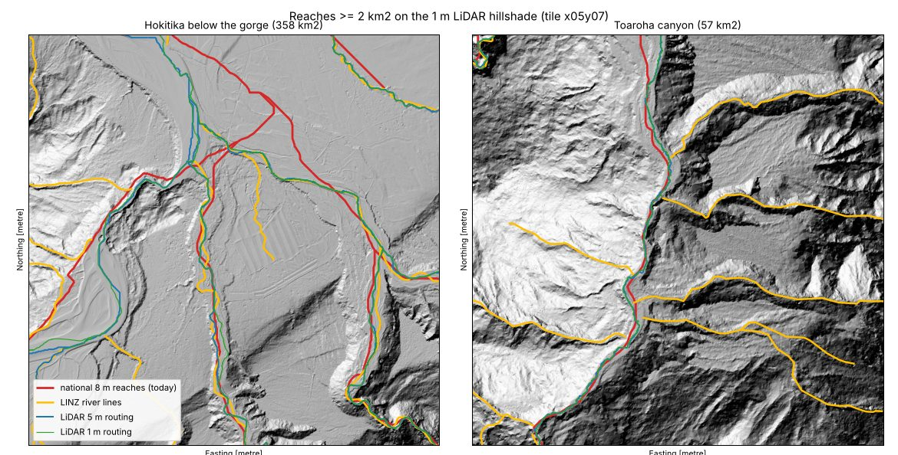

# 1 m LiDAR national pipeline: design and benchmark (rf-lxa.2)

How the national scan moves from the 8 m contour DEM to the LINZ 1 m LiDAR DEM on this machine (4 cores, 15 GB
RAM, ~11 GB of free disk), measured on one benchmark tile, and how the dependent issues (rf-t26.11, rf-3ri.6,
rf-33a.4, rf-3ri.7, rf-a33) are handled. Coverage, water surfaces and the fallback rule come from
[`lidar-coverage.md`](lidar-coverage.md) (rf-lxa.1); the per-reach attribute list is rf-lxa.3
([`lidar-extraction-spec.md`](lidar-extraction-spec.md)).

Code: `src/river_finder/lidarpipe.py` (reusable pieces, tests in `tests/test_lidarpipe.py`) and
`src/river_finder/lidarbench.py` (the benchmark: `river-finder lidar bench stream | speed | route | compare | tiling |
seam | lakes | report`). Outputs (gitignored): `data/analysis/lidar-bench/` (`stream.json`, `variants/<v>/` with
`segments.gpkg`, `rec2.csv`, `paths.npz`, `route.json`; `eval.json`, `tiling.json`, `seam.json`, `lake.json`,
`rotorua.json`, `tables.md` with every table below).

## Summary and recommendation

- **Read the 1 m mosaic at full resolution, in parallel, and keep nothing at 1 m.** Block-aligned 2048 x 2048 windows
  with 24-32 threads read **60-78 M cells/s** (the whole 70 x 70 km benchmark box, 4.9 G cells, in 81 s); the
  earlier 2-4 M cells/s were latency bound (1-8 threads). The whole country (~271 G LiDAR cells inside the tile boxes)
  streams in **~1.3 h**. Overviews are never read (0.1 m LERC quantisation, rf-lxa.1).
- **Route at 5 m from the 1 m block mean** on the national 64 km tiles with a 3 km halo (196 M cells per box) using a
  memory-lean version of `routing.py` (same receivers; 15-20 bytes per cell instead of ~66): **~2 min and 3.8 GB per
  tile**. The 5 m line lies **1.5 m (median), 6.3 m (p90) from the 1 m channel**, its height above the 1 m channel is
  0.0 m (median) / 0.3 m (p90); today's 8 m lines: 11 m / 70 m and 1.5 m / 8.8 m (58 % of their length more than 1 m
  above the channel, i.e. on banks and terraces). 2 m routing halves the 5 m offsets (0.7 / 4.4 m) for 6x the cells;
  1 m routing costs ~40-60 h of routing alone and tiles of ~19 km.
- **Sample every profile at 1 m along the 5 m line**: the lowest 1 m cell within half a routing cell + 1 m of each
  vertex, its running minimum, distances along the line smoothed over 20 m. Drops, gradients and the steepest 100-200
  m stretches then agree with the 1 m routing within ~5 % (one section 8 %); today's 8 m profiles are 3-12 % too steep
  and their "steepest 50 m" is 2-7x the 1 m value on half the guide sections. Cross-sections: 1 m for the low stages,
  the 5 m DEM for the 10-20 m stages (rf-lxa.4).
- **Do not burn the LINZ river lines** (rf-3ri.7): a 1-3 m burn moves the lines towards LINZ (median 8.7 -> 3.4 -> 2.2
  m) but off the 1 m channel (1.6 -> 2.3 -> 3.0 m; share more than 1 m above the channel 4.8 -> 9.9 -> 17.8 %). The
  LiDAR channel is better placed than the LINZ lines; use LINZ for names, not geometry.
- **Lakes**: no-data lake interiors filled flat at the LiDAR water level of their rim drain cleanly through one outlet
  (Lake Rotorua: the whole lake through the Ohau Channel, 6 shore cells with a step > 0.5 m, against 17,636 when filled
  from the 8 m DEM at 282.0 m); the sea needs the 8 m land mask, because the surveys flatten coastal water too.
- **Seams**: correct the 8 m fallback with the seam rule of rf-lxa.1 plus an edge blend (the correction equals the
  adjacent LiDAR cell's offset on the first gap cell): step across the seam on channels 0.16 m (median) / 0.77 m (p90)
  against 5.7 / 14.7 m for a hard switch and 2.4 / 10.6 m for the Gaussian-only rule.
- **Tile edges** (rf-t26.11): keep REC2 inflows to make channels and per-cell areas at the box edge, but take every
  reach's area from **network accumulation of local catchment areas over the stitched national network** with **lakes
  as single nodes**: tested on 2 x 2 sub-tiles, the reach network is identical to the whole tile and rivers over 100
  km2 come out within 1 % (REC2 inflows: within 1.7 %, 5 % of them off by more than 1 %).
- **Country**: ~6.5-8 h for the national pass on this machine (route + 1 m extraction, ~5.5 min per full tile, 70
  full-tile equivalents), peak ~5 GB, transient disk ~0.2 GB per tile, kept outputs ~4 GB (minimal) to ~10 GB (with
  raw cross-section stacks): it does not fit next to today's data in this session's ~8 GB; run it in a fresh session
  with >= 20 GB free, or delete the 8 m tile rasters (2.9 GB) first and keep the minimal outputs.

## Decisions (2026-11-26)

The user settled the open decisions as follows. Where they differ from the recommendations above, these decisions
apply.

- **Routing at 2 m, not 5 m.** The 2 m block mean of the full-resolution 1 m cells is routed with the lean router
  on tiles of about 32 km core with a 3 km halo. That is about 200 tiles, each a 38 km box of about 361 M cells. The
  estimate is ~9 GB peak and ~15 h for the country. Lines lie 0.7 m (median) / 4.4 m (p90) from the 1 m channel.
  Profiles and cross-sections are still sampled at 1 m. The 10-20 m section stages come from the 2 m DEM, which is
  already in memory. Products such as the area code and hillshade stay at 5-10 m. Before the national run,
  measure memory and time on one full 2 m tile (rf-lxa.6).
- **Reach geometry from the LiDAR routing, LINZ for names only** (rf-3ri.7). Each reach records `linz_dist_m`. Spot-
  check the lines against the LINZ aerial photos, because the benchmark used the LiDAR itself as the reference.
- **The reference areas are processed in the national run** (kaimai, karangahake, tutamoe). This gives one
  resolution and one method everywhere, and closes rf-3ri.6.
- **The national mosaic is the only LiDAR source.** The 2026 surveys that are newer than the mosaic are not read.
- **Reach areas** come from network accumulation of local catchment areas over the stitched national network
  (rf-lxa.5). With smaller tiles this matters even more. REC2 inflows are kept as a check.
- **Disk**: decided when the run starts. Plan on a fresh session with at least 20 GB free.

## Benchmark setup

- **Tile `x05y07`** (West Coast, Hokitika to Harihari and the Main Divide; box = 64 km core + 3 km halo =
  1,389,000-1,459,000 E, 5,181,000-5,251,000 N; 12 mosaic sheets BV16-BX19, survey `west-coast_2020-2022`). The
  LiDAR reaches the coastline: no land falls back to the 8 m DEM here (only the sea, 13 M 5 m cells, and
  Lake Ianthe's interior, 1.38 km2, are no data).
- **Sub-area `SUB`** (1,437,000-1,457,000 E, 5,229,000-5,250,000 N: 20 x 21 km, 420 M 1 m cells): Hokitika gorge
  and Kakariki canyon, the Hokitika from Mungo to Nogo and Nogo to Kakariki, Whitcombe, Toaroha (three sections),
  Kokatahi, Styx. Routed at 1 m (the reference "1 m channel"), 2 m and 5 m on the same box.
- **Variants**: `c8` today's 8 m contour DEM (reproduces the national tile exactly: 14,746 core reaches, same areas
  and lengths); `l8` LiDAR 8 m block mean; `l5mean` / `l5min` LiDAR 5 m block mean / minimum; `l5min_b1` / `_b3` LINZ
  lines burnt 1 / 3 m; `s5min`, `s2mean`, `s2min`, `s1` on the sub-area. Every variant is routed as `nz.route_tile`
  routes a tile: REC2 border outlets, REC2 inflows at the box edge, lake fill, 8 m fallback with seam correction;
  reaches of >= 0.5 km2 cut every ~250 m. Means and minima are of the full-resolution 1 m cells (no overviews).
- **References**: the 1 m channel (`s1` reaches, every 1 m), the LINZ river lines (LDS 103632, `river_cl`, from
  `data/nz/linz/`), REC2 `cum_area_km2` (method of `validate.py`: strict = max area within 32 m, 100 m above the REC2
  reach's end; tolerant = growing radius), the guide put-ins and take-outs (`models.all_sections`, 26 sections with a
  point in the core).



*Reaches of >= 2 km2: today's 8 m reaches (red) cut across the terrace below the Hokitika gorge and run on the
canyon rims; the 5 m (blue) and 1 m (green) LiDAR channels lie on top of each other in the river; the LINZ lines
(yellow) follow the river with offsets of tens of metres in the wide bed.*

## Results

### Reading the 1 m mosaic

| read | M cells | s | M cells/s |
|---|---:|---:|---:|
| 8 threads x 2048 windows | 292 | 6.5 | 44.9 |
| 16 threads x 2048 | 270 | 4.2 | 64.8 |
| 32 threads x 2048 | 291 | 3.7 | 78.5 |
| 48 threads x 2048 | 291 | 10.7 | 27.1 (throttled or slow blocks; not repeatable) |
| **whole tile box, 32 threads, aggregating to 5 m and 8 m** | 4,900 | 80.7 | **60.7** |

The reads are latency bound (CPU 5-7 s per 500 M cells: LERC decodes at ~80 M cells/s per core). In the tile run the
consumer (water flags, two aggregations in the main thread) took 71 of the 81 s, so moving the aggregation into the
reader threads (numba `nogil`) would read faster still. Memory: the 5 m aggregate (float64 sum, minimum, counts) is
15 bytes per 5 m cell (2.9 GB per tile box); the benchmark also held the 8 m aggregate and the 1 m sub-area (peak 10.7
GB while writing; a production stream holds only the 5 m aggregate).

### Routing cost (lean router)

`lidarpipe.route_lean` is `routing.route` with float32 elevations filled in place, uint8 direction codes, a growable
heap and FIFO, flat resolution on arrays sized to the flats and a queue-free accumulation. Its receivers equal
`routing.route`'s on every test DEM, and on the 8 m tile it reproduces the national product reach for reach.

| variant | cell m | M cells | flood s | D8 s | flats s | total s | us / cell | peak GB | reaches |
|---|---:|---:|---:|---:|---:|---:|---:|---:|---:|
| 8 m contour (today) | 8 | 77 | 28.0 | 1.3 | 0.6 | 37.9 | 0.50 | 1.54 | 17,441 |
| LiDAR 8 m mean | 8 | 77 | 27.7 | 2.0 | 0.8 | 41.9 | 0.55 | 1.71 | 20,654 |
| **LiDAR 5 m mean** | 5 | 196 | 87.1 | 5.6 | 3.6 | **123.1** | 0.63 | **3.84** | 21,068 |
| LiDAR 5 m min | 5 | 196 | 88.2 | 5.6 | 3.5 | 196.7 * | 1.00 | 11.92 * | 21,316 |
| LiDAR 2 m mean (sub-area) | 2 | 105 | 39.9 | 2.6 | 0.8 | 49.8 | 0.47 | 1.90 | 1,955 |
| LiDAR 1 m (sub-area) | 1 | 420 | 191.0 | 10.8 | 4.9 | 230.7 | 0.55 | 6.32 | 2,097 |

\* includes the one-off measurement of the per-tile product sizes, whose unchunked float64 temporaries peaked at
11.9 GB (now chunked in the code; routing itself peaked at 3.3 GB). "total" = load, lake fill and fallback, route,
accumulate with REC2 inflows, REC2 check, reaches, guide paths. Today's 8 m tiles peak at ~12 GB with `reaches.py`
(~150 bytes per cell); the 1 m pass needs the extraction (rf-lxa.3) written as lean as the router.

At ~0.5 us per cell (flood, D8, flats) the country costs, in routing alone: **8 m ~0.7 h (5.0 G cells; today's router
took 1.8 h), 5 m ~1.7 h (12.8 G cells), 2 m ~10 h (80 G cells, ~200 tiles of ~38 km to stay under ~9 GB), 1 m ~40-60 h
(271 G LiDAR cells, ~700 tiles of ~19 km whose 3 km halos add ~70 %)**.

### Channel position (reaches >= 2 km2; p50 / p90, m)

"1 m channel": the nearest 1 m reach of similar area (0.5-2x); "height": the 1 m DEM at the line minus the 1 m DEM
at that channel point (a line on a bank or terrace is high). "LINZ": the nearest LINZ river line.

| variant | to 1 m channel (sub-area) | >= 100 km2 | height above it | share > 1 m above | to LINZ (sub-area) | >= 100 km2 | share > 20 m from LINZ | to LINZ (core) |
|---|---:|---:|---:|---:|---:|---:|---:|---:|
| national 8 m reaches (today) | 10.1 / 48.4 | 19.9 / 111 | 1.5 / 9.3 | 0.57 | 15.4 / 198 | 115 / 332 | 0.43 | 20.2 / 291 |
| 8 m contour (re-routed) | 11.1 / 70.5 | 22.7 / 145 | 1.5 / 8.8 | 0.58 | 19.9 / 235 | 131 / 351 | 0.50 | 20.3 / 286 |
| LiDAR 8 m mean | 2.1 / 7.6 | 5.4 / 18.3 | 0.0 / 0.6 | 0.055 | 8.1 / 156 | 103 / 254 | 0.33 | 16.1 / 300 |
| **LiDAR 5 m mean** | **1.5 / 6.3** | 3.7 / 18.4 | **0.0 / 0.3** | **0.029** | 8.6 / 161 | 103 / 256 | 0.34 | 16.2 / 297 |
| LiDAR 5 m min | 1.6 / 7.8 | 3.0 / 21.1 | 0.0 / 0.5 | 0.048 | 8.7 / 159 | 103 / 253 | 0.33 | 16.3 / 303 |
| 5 m min + LINZ burn 1 m | 2.3 / 10.1 | 3.5 / 21.5 | 0.0 / 1.0 | 0.099 | 3.4 / 156 | 102 / 253 | 0.31 | 10.8 / 297 |
| 5 m min + LINZ burn 3 m | 3.0 / 13.0 | 3.5 / 21.6 | 0.1 / 1.7 | 0.178 | 2.2 / 157 | 103 / 253 | 0.30 | 2.5 / 290 |
| LiDAR 2 m mean (sub-area) | 0.7 / 4.4 | 1.6 / 10.6 | 0.0 / 0.1 | 0.009 | 9.0 / 160 | 99 / 262 | 0.34 | - |
| LiDAR 2 m min (sub-area) | 0.8 / 5.1 | 1.5 / 10.7 | 0.0 / 0.2 | 0.011 | 9.2 / 160 | 99 / 262 | 0.34 | - |
| LiDAR 1 m (sub-area) | (0.5) | (0.5) | 0 | 0.002 | 9.1 / 163 | 100 / 263 | 0.35 | - |

- The data, not the cell size, moves the line: LiDAR at 8 m is already 5x closer to the 1 m channel than the contour
  DEM at 8 m. 5 m gains a little over 8 m, 2 m halves the remaining offset; the height above the channel shows the 5 m
  line is in the channel (p90 0.3 m) and today's line often is not (median 1.5 m, p90 9 m above it).
- The LiDAR channels are 9 m (median) from the LINZ lines, but ~100 m on the large rivers: LINZ draws the centre of
  the wide gravel bed, the 1 m D8 path follows the lowest (wetted, interpolated) braid. Seen from the LINZ side (named
  lines in the sub-area, nearest 1 m reach of >= 2 km2): median 20 m, 50 % farther than 20 m, 62 % of the LINZ points
  more than 1 m above the channel (on bars and banks).
- Guide put-ins and take-outs do not discriminate: every variant is 52-81 m (median) from them, LINZ 61 m; their
  coordinates are road ends, huts and bridges, often rounded.

### Catchment area against REC2 (reaches >= 5 km2)

| variant | core n | median abs err | within 10 % | within 10 % tolerant | sub-area within 10 % | tolerant | sub-area >= 20 km2 |
|---|---:|---:|---:|---:|---:|---:|---:|
| 8 m contour (today) | 2,198 | 0.025 | 0.62 | 0.76 | 0.79 | 0.87 | 0.81 |
| LiDAR 8 m mean | 2,198 | 0.023 | 0.67 | 0.80 | 0.82 | 0.89 | 0.85 |
| LiDAR 5 m mean | 2,198 | 0.022 | 0.67 | 0.81 | 0.82 | 0.90 | 0.84 |
| LiDAR 5 m min | 2,198 | 0.022 | 0.67 | 0.81 | 0.83 | 0.90 | 0.85 |
| 5 m min + LINZ burn 3 m | 2,198 | 0.019 | 0.71 | 0.81 | 0.84 | 0.91 | 0.85 |
| LiDAR 2 m (sub-area) | 224 (sub core) | 0.018 | 0.82 | 0.89 | 0.80 | 0.88 | 0.84 |
| LiDAR 1 m (sub-area) | 224 (sub core) | 0.017 | 0.84 | 0.90 | 0.82 | 0.89 | 0.86 |

LiDAR raises the within-10 % share by 5 points (strict) and 5 points (tolerant); the resolution after that does not
matter (5 m = 2 m = 1 m). The remaining gap is REC2 itself (a 30 m network) and the strict 32 m snap at confluences
(the strict-tolerant difference, 14 points): see rf-33a.4 below.

### Long profiles on the guide sections

Each variant's routed line from the guide put-in (snapped to the largest channel within 150 m) to its take-out,
sampled on the 1 m DEM (lowest 1 m cell within half a routing cell + 1 m of the line, downstream running minimum),
distances along the line smoothed over 20 m. "own": the routing DEM's own filled profile (what `reaches.py` measures
today). Sub-area sections, against the 1 m routing (steepest stretches in m/km):

| section | variant | length m | drop m | m/km | steepest 100 m | steepest 200 m | steepest 50 m own |
|---|---|---:|---:|---:|---:|---:|---:|
| Hokitika, Mungo to Nogo (5) | 1 m | 7,336 | 224.2 | 30.6 | 212 | 128 | 263 |
| | 2 m min | 7,261 | 224.4 | 30.9 | 213 | 128 | 258 |
| | 5 m min | 7,250 | 224.3 | 30.9 | 201 | 127 | 249 |
| | 8 m contour (today) | 7,118 | 224.5 | 31.5 | 227 | 171 | 190 |
| Hokitika, Nogo to Kakariki (5) | 1 m | 5,816 | 175.0 | 30.1 | 138 | 98 | 232 |
| | 5 m min | 5,729 | 173.3 | 30.2 | 137 | 100 | 240 |
| | 8 m contour | 5,529 | 174.3 | 31.5 | 145 | 106 | 215 |
| Kokatahi (5) | 1 m | 8,939 | 293.0 | 32.8 | 130 | 80 | 188 |
| | 5 m min | 8,819 | 292.0 | 33.1 | 134 | 82 | 205 |
| | 8 m contour | 8,640 | 293.4 | 34.0 | 137 | 83 | 287 |
| Styx (4+) | 1 m | 3,968 | 120.0 | 30.3 | 77 | 71 | 101 |
| | 5 m min | 3,947 | 119.6 | 30.3 | 79 | 73 | 95 |
| | 8 m contour | 3,876 | 123.9 | 32.0 | 110 | 86 | 154 |
| Toaroha, lower (3-4) | 1 m | 1,454 | 26.8 | 18.5 | 48 | 31 | 71 |
| | 5 m min | 1,467 | 27.3 | 18.6 | 49 | 32 | 74 |
| | 8 m contour | 1,354 | 28.0 | 20.7 | 50 | 31 | 145 |
| Toaroha canyon (5) | 1 m | 4,606 | 196.8 | 42.7 | 252 | 177 | 367 |
| | 5 m min | 4,556 | 197.2 | 43.3 | 257 | 192 | 381 |
| | 8 m contour | 4,331 | 196.9 | 45.5 | 282 | 193 | 416 |
| Toaroha, upper (4+) | 1 m | 8,540 | 490.6 | 57.5 | 395 | 324 | 422 |
| | 5 m min | 8,404 | 490.2 | 58.3 | 407 | 324 | 451 |
| | 8 m contour | 8,127 | 492.6 | 60.6 | 423 | 333 | 401 |

(2 m and 8 m LiDAR rows, and the raw 50 m windows, are in `tables.md`.) The 5 m line is between 1.6 % shorter and
0.9 % longer than the 1 m one and its gradients 0.1-1.5 % higher; its steepest 100-200 m stretches are within -5 % to
+8 % of the 1 m values. Today's 8 m lines are 2-7 % shorter (cut corners, rims), their gradients 3-12 % too high,
steepest 200 m up to +34 %.

All guide sections in the tile, today's 8 m profile against the 5 m line sampled at 1 m:

| section | km2 | drop on 1 m | drop 8 m own | steepest 50 m, 8 m own | steepest 50 m, 5 m own | steepest 50 m on 1 m | longest flat 8 m own | longest flat 5 m own | flattened / planar water on path |
|---|---:|---:|---:|---:|---:|---:|---:|---:|---|
| Hokitika, Kakariki canyon (4) | 358 | 89.3 | 97.1 | 123 | 56 | 49 | 2,147 | 184 | 21 % / 45 % |
| Kakapotahi, upper (5) | 84 | 110.3 | 119.9 | 187 | 98 | 92 | 842 | 196 | 0 / 4 % |
| Kakapotahi, mid gorge (5) | 84 | 78.3 | 80.3 | 187 | 57 | 71 | 842 | 159 | 0 / 4 % |
| Totara (3+) | 28 | 47.5 | 45.9 | 294 | 43 | 43 | 472 | 85 | 0 / 3 % |
| Toaroha, lower (3-4) | 62 | 27.3 | 19.4 | 145 | 74 | 75 | 648 | 120 | 0 / 3 % |
| Waitaha, Morgan Gorge (5) | 85 | 97.0 | 99.1 | 166 | 137 | 141 | 215 | 101 | 0 / 2 % |
| Wanganui (4) | 266 | 207.0 | 218.4 | 206 | 92 | 92 | 1,465 | 94 | 4 % / 41 % |
| Wanganui (3) | 266 | 101.4 | 100.6 | 121 | 55 | 56 | 1,465 | 94 | 5 % / 57 % |

- The 5 m DEM's own profile already agrees with the 1 m one (steepest 50 m mostly within 5 %, at worst 19 %); the 8 m
  contour profile has fake steep spots (2-7x on about half the sections) where the line drops off rims, drops off by
  up to 30 % (Toaroha lower) and zero-gradient stretches of up to 2.1 km that LiDAR does not have (rf-a33).
- On the big West Coast rivers 41-57 % of the path is on interpolated water and up to 21 % on flattened treads: there,
  use the running minimum and 100-200 m windows (rf-lxa.1); on the gorges and creeks the water share is 0-4 %, so the
  1 m profile is the bed and its steps are real.

### Zero-gradient reaches (rf-a33; reaches >= 2 km2 with < 1 cm of drop)

| variant | core km | zero share (core) | km in zero stretches > 1 km (core) | zero share (sub-area) |
|---|---:|---:|---:|---:|
| 8 m contour (today) | 1,910 | 9.3 % | 124 | 7.3 % |
| LiDAR 8 m mean | 2,200 | 3.6 % | 58 | 0.4 % |
| LiDAR 5 m mean | 2,241 | 3.4 % | 53 | 0.5 % |
| LiDAR 2 m / 1 m (sub-area box) | - | - | - | 1.1 % / 0.9 % |

The LiDAR zero stretches over 1 km are lakes and flat lowland: Lake Ianthe (29.7 m) and two lakes at 690 m and 1,100 m
(hydro-flattened in the LiDAR), coastal wetland plains at 1.7-2.6 m and estuaries at the coastal water level (-1.42 m).
Today's 8 m zero stretches are rivers (the Wanganui at 37 m, 398 km2; the Perth plain). LiDAR plus the lake flag
(`lake`) removes rf-a33's problem.

### LINZ line burn (rf-3ri.7)

From the tables above: burning the LINZ lines 1 m / 3 m into the 5 m DEM moves the reach lines towards LINZ (sub-area
median 8.7 -> 3.4 -> 2.2 m; core 16.3 -> 10.8 -> 2.5 m) and improves REC2 slightly (strict 67 -> 69 -> 71 %), but
moves them off the 1 m channel (1.6 -> 2.3 -> 3.0 m median, p90 7.8 -> 10.1 -> 13.0 m), puts twice to four times as
much of them more than 1 m above it (4.8 -> 9.9 -> 17.8 %), and adds zero-gradient reaches (3.7 -> 3.9 -> 5.3 %).
At 5 m from LiDAR a burn is not needed and does harm.

### Second read along the channels

Share of the core's 512 m blocks (the COG block size) a corridor around the 5 m reaches touches (re-read at 1 m for the
profiles and cross-sections):

| corridor | reach km | block share | area share |
|---|---:|---:|---:|
| reaches >= 0.5 km2, +-50 m | 5,239 | 0.58 | 0.10 |
| reaches >= 0.5 km2, +-150 m | 5,239 | 0.68 | 0.26 |
| reaches >= 2 km2, +-150 m | 2,754 | 0.41 | 0.14 |
| reaches >= 2 km2, +-500 m | 2,754 | 0.65 | 0.41 |
| reaches >= 10 km2, +-150 m | 1,209 | 0.19 | 0.06 |

A second read of the corridor blocks costs 40-70 % of the first read (~35-55 s per tile).

### Tiling: 2 x 2 sub-tiles of 32 km (3 km halo) against the whole tile

The 5 m tile routed as four 32 km tiles with 3 km halos, each as `nz.route_tile` does (REC2 border outlets and
inflows). *inflow*: each sub-tile's own areas (REC2 inflows at its box edge), against the whole-tile run. *network*:
each sub-tile counts the cells of its box whose first reach is one of its core reaches (`lidarpipe.local_areas`),
reaches leaving a core are stitched to the neighbour's reach within 8 m, and areas are accumulated down the stitched
network; compared with the whole tile under the same rule.

| areas | reaches | n | err > 1 % | err > 5 % | within 2 km of an internal edge | err > 5 % there | max err |
|---|---|---:|---:|---:|---:|---:|---:|
| REC2 inflow | >= 2 km2 | 9,296 | 2.6 % | 0.3 % | 1,182 | 2.1 % | 16 % |
| | >= 10 km2 | 3,992 | 5.6 % | 0.4 % | 493 | 2.6 % | 10 % |
| | >= 100 km2 | 1,002 | 5.0 % | 0 | 96 | 0 | 1.7 % |
| network | >= 2 km2 | 9,296 | 2.3 % | 0.6 % | 1,182 | 4.3 % | 140 % |
| | >= 10 km2 | 3,992 | 4.9 % | 0.8 % | 493 | 6.5 % | 13 % |
| | >= 100 km2 | 1,002 | 0.2 % | 0 | 96 | 0 | 1.0 % |

- With LiDAR the overlapping halos route identically: the sub-tiles give **the same 17,875 core reaches** as the whole
  tile, and 32 of the 36 reaches that cross an internal edge stitch exactly (the 4 others are streams of 0.6-3 km2).
- REC2 inflows are approximate (the REC2 area at the crossing, snapped to the largest channel within 48 m): 5 % of the
  big rivers are 1-2 % off. The network areas are exact for the big rivers; their misses are local (an unstitched or
  mis-stitched small stream near an edge: 4 % of the reaches near an edge).
- Truncation: 0 of the whole tile's core reaches are truncated (64 km core, 3 km halo, REC2 inflows), 183 with 32 km
  tiles.

### Seams: a 12 x 20 km block treated as a LiDAR gap

The Whitcombe and upper Hokitika headwaters (1,440,000-1,452,000 E, 5,195,000-5,215,000 N) filled from the 8 m DEM
(8 m minus LiDAR at the seam: median +2.1 m, |p90| 12.6 m: steep mountain terrain) and routed at 5 m with the rest of
the box on LiDAR, against the true LiDAR. "step": the elevation change across the seam minus the true one, for every
pair of cells either side.

| rule | step p50 / p90 m | share > 1 m | on channels p50 / p90 m | filled cells (> 0.5 m) at the seam | s |
|---|---:|---:|---:|---:|---:|
| hard switch | 4.94 / 12.6 | 0.89 | 5.73 / 14.7 | 1,702 | 0.1 |
| rf-lxa.1 rule (Gaussian 150 m on a 25 m grid, 1 km taper) | 2.58 / 8.3 | 0.75 | 2.43 / 10.6 | 1,309 | 4 |
| same, sigma 50 m on the 5 m grid | 1.98 / 6.9 | 0.67 | 1.37 / 6.7 | 1,389 | 15 |
| **+ edge blend (25 m) on the 5 m grid** | **0.47 / 2.3** | **0.28** | **0.16 / 0.77** | **805** | 26 |
| true LiDAR | 0 | 0 | 0 | 33 | |

The smoothed correction only matches the LiDAR at its smoothing scale, so the seam keeps steps of metres where the 8 m
DEM wiggles; the edge blend (`seam_correct(..., edge_m=25)`: next to the seam the correction is the offset of the
nearest LiDAR cell, blended into the smooth field with weight exp(-d / 25 m)) makes the surface continuous cell by
cell. The rest of the gap keeps the 8 m DEM's own faults (its depressions: ~800 filled cells at the seam remain).

### Lakes

| lake | hole km2 | lake km2 | LiDAR level | 8 m DEM in the hole | fill | where the lake drains | share of the lake there | shore cells with a step > 0.5 m |
|---|---:|---:|---:|---:|---|---|---:|---:|
| Lake Ianthe (x05y07) | 1.38 | 4.8 | 29.716 | 27.0 | LiDAR level | its outlet (170.597, -43.076) | 100 % | 0 |
| | | | | | 8 m DEM | same | 100 % | 2,296 |
| Lake Rotorua (x12y16) | 62.2 | 80.8 | 279.5 | 282.0 | LiDAR level | Ohau Channel (176.324, -38.046) | 100 % | 6 |
| | | | | | 8 m DEM | same | 100 % | 17,636 |

Lake Rotorua's 20 x 22 km box was streamed at 1 m into 5 m in 8 s. Both fills drain the lake through its real outlet
(the flood fills the 8 m plateau's surroundings), but the 8 m fill leaves a 2.5 m (Rotorua) or 2.7 m (Ianthe) step all
round the lake interior, which the reaches crossing it would see as falls. The rim rule found every lake hole of the
tile; it also found the sea, whose rim is hydro-flattened coastal water at -1.42 m in the West Coast survey: a hole is
a lake only where the 8 m DEM has land (`fill_lakes(..., land=...)`; the 8 m DEM has lakes but no sea).

### Per-tile products at 5 m (64 km core, compressed)

| file | MB |
|---|---:|
| area code, uint8 (today's `area_code.tif` at 5 m) | 86.9 |
| D8 directions, uint8 | 36.6 |
| filled DEM, float32 LERC 1 mm / lossless zstd | 278.8 / 350.4 |
| local catchment, int32 | 7.5 |
| hillshade 25 m | 5.7 |
| reach lines, 5 m vertices (gpkg) | 17.6 |
| 8 m contour DEM of the box (transient, fallback) | 155 |

## Design

### Resolution and sampling

- **Routing grid: 5 m, block mean of the full-resolution 1 m cells**, with the 8 m DEM (bilinear) where there is no
  LiDAR. Mean and minimum route alike (the mean is slightly closer to the 1 m channel: 1.5 / 6.3 m against 1.6 / 7.8
  m; equal REC2 agreement and profiles); the mean is unbiased for the terrain metrics (HAND, valley width, relief).
  A minimum adds no connectivity the 1 m sampling does not already give.
- **Profiles on the 1 m DEM** along each 5 m reach: per vertex the lowest 1 m cell within 3.5 m (half a cell + 1 m),
  downstream running minimum, distances along the line smoothed over 20 m (`lidarpipe.smooth_distance`); gradient,
  steepest 100 / 200 m (and the raw 50 m with the steps flagged as in rf-lxa.1), `water_flat_share` and
  `water_planar_share` from the 1 m water flags. Store the 1 m profile per reach (rf-lxa.3) so later features need no
  reread.
- **Cross-sections**: perpendicular to the smoothed 5 m line, sampled on the 1 m DEM out to +-150 m (stages 0.5-5 m,
  banks, channel shape: rf-lxa.4) and on the 5 m DEM out to +-500 m (10-20 m stages, walls), recentred on the 1 m
  bottom.
- **Not 2 m or 1 m routing**: 2 m costs ~6x (80 G cells, ~200 tiles of ~38 km) for 0.8 m less offset; profiles
  sampled at 1 m are already within ~5 %. 1 m routing (~40-60 h of routing, ~700 tiles of ~19 km) also
  inherits the 1 m problems: flattened treads and interpolated braids are large flats, and D8 paths 8 % too long.

### Tiles, halo and edges (rf-t26.11, rf-3ri.6)

- **Keep the national grid**: 64 km tiles at X0/Y0, the same ids, 3 km halo (70 km box, 14,000 x 14,000 cells at 5
  m). Routing peaks at 3.8 GB; the whole per-tile job at ~5 GB if the extraction is written lean. A larger halo is not
  needed: the 2 x 2 test reproduces the network exactly with 3 km.
- **Per tile**: REC2 border outlets and REC2 inflows as today (they make the channels that enter the box and give
  in-tile areas for the channel threshold and the area raster); keep the core.
- **National merge**: stitch reaches that leave a core to the neighbour's reach at the end point (same data in the
  overlap -> same path; 8 m tolerance, area ratio 0.7-3), relink along REC2 only as the fallback, then
  **recompute every reach's area by accumulating local catchment areas down the merged network**: each tile reports,
  per core reach, the cells of its box (core and halo) that first drain into it (each cell is counted once, by the
  tile whose core holds its first reach). Keep the REC2-inflow area as a check (`area_check`), flag reaches where they
  differ by more than 10 %. Area-dependent attributes (ksn, MAF, stream power, area-normalised features) are computed
  after the merge from the network area.
- **Lakes as nodes**: a national lake table, built once before the tiles (lake holes and hydro-flattened water bodies
  of >= ~0.1 km2 from a coarse national pass of the coverage layer, the 8 m DEM and the 5 m water shares): polygon,
  LiDAR water level (one level per lake for every tile, e.g. Taupo 356.23 m), outlet. Each tile fills the holes at that
  level; every reach that ends in a lake links to the lake's outlet reach, whichever tile holds it. Lakes split by
  tiles (Taupo, Wakatipu, Hawea, Te Anau) and the Taupo gap then carry their whole catchment downstream (the Waikato at
  the gates gets Taupo's ~3,300 km2), and the 26 unresolved outlets of rf-t26.11 are reconnected by the network
  rather than by the per-tile routing.
- **Truncation** (rf-3ri.6): with network areas a reach is truncated only if its upstream network reaches a box edge
  without a stitch or an inflow; at 64 km with 3 km halos and REC2 inflows the benchmark tile has none. The reference
  areas should be folded into the national run (they are 100 % LiDAR), which retires their bbox + buffer problem.

### Lakes, fallback and seams

1. Read the national mosaic only (rf-lxa.1). The LiDAR's no-data cells are the sea, lake interiors and the gaps.
2. **Lake holes**: holes whose rim is >= 50 % hydro-flattened, with a modal rim level holding >= 40 % of it, and which
   are >= 50 % land in the 8 m DEM: fill flat at the rim's level (the lake table's level for lakes across tiles).
3. **Land gaps**: the 8 m DEM bilinear to the 5 m grid, corrected by the seam rule with the **edge blend**
   (`seam_correct(z, z8, 5, sigma_m=150, taper_m=1000, work_m=5, edge_m=25)`), computed in windows around each gap
   edge (the distance transforms of a whole 5 m tile would need ~5 GB).
4. Per-reach flags as in rf-lxa.1 (`dem_source`, `lidar_share`, `seam_dist_m`, `lake`, ...).

### Streaming, disk and what is kept per tile

Per tile, one job, resumable by a `tile.json` done flag as today:

1. Prefetch the next tile's 8 m DEM (51 s, 155 MB on disk; a thread, as `nz.run_tiles` does).
2. Stream the box's 1 m windows (block aligned, 24-32 threads) into the 5 m block mean and the water shares (~80 s,
   2.9 GB; aggregation in the reader threads).
3. Lake fill, fallback and seams (~15 s); route (~100 s); accumulate with REC2 inflows; reaches; local catchments.
4. **Extraction pass in the same job**: re-read the 1 m windows along the reaches (40-70 % of the blocks, ~35-55 s)
   and extract profiles, cross-sections and steps (rf-lxa.3; cost to be measured there, the 8 m `xsec` took 33 s per
   tile).
5. Write the kept products, delete the 8 m DEM. Nothing at 1 m ever reaches the disk; the 5 m DEM is not kept (the
   extraction ran while it was in memory).

Kept per full tile: reach lines (18 MB), local catchment int32 5 m (7.5 MB), area code (87 MB at 5 m, or ~22 MB as a
10 m maximum, which is all the viewer mosaics use), hillshade 25 m (6 MB), tile stats, plus the extraction store
(rf-lxa.3: 1 m profiles and section stacks, roughly 10-60 MB per tile depending on what is kept). Transient: ~0.2 GB.

### National estimate (115 land tiles = 70 full-tile equivalents of valid 5 m cells; LiDAR on ~85 %)

| step | per full tile | country |
|---|---:|---:|
| stream 1 m -> 5 m | 81 s | 1.6 h (1.3 h by valid cells) |
| 8 m DEM fetch | 51 s (overlapped) | - |
| lake fill, fallback, seams | 15 s | 0.3 h |
| routing at 5 m | 100 s | 2.0 h |
| accumulate, inflows, reaches, local catchments | 15 s | 0.3 h |
| 1 m re-read along the reaches | 35-55 s | 0.7-1.1 h |
| extraction (rf-lxa.3, estimate) | 60-120 s | 1.2-2.3 h |
| products | 30 s | 0.6 h |
| **total** | **~5.5-7 min** | **~6.5-8 h** (merge, stitching, lakes, network areas: minutes) |

Peak memory ~5 GB (routing 3.8 GB); disk ~0.2 GB transient per tile; kept outputs ~4 GB (area code at 10 m, compact
extraction store) to ~10 GB (area code at 5 m, raw section stacks). This session has ~8 GB free next to 16 GB of
`data/`: the minimal outputs fit if the run deletes nothing else, but there is no room for both today's 8 m tiles and
a 1 m-derived set at full size. **Recommended: a fresh session with >= 20 GB free**, or delete `data/nz/tiles/*`
rasters (2.9 GB; recomputable in ~4 h) once the 1 m set replaces them.

## Dependent issues

- **rf-t26.11** (big rivers end at tile edges, lakes split, Taupo gap): handled by design: network-accumulated areas
  over the stitched national network (exact for rivers > 100 km2 in the 2 x 2 test) and lakes as single nodes with one
  national level and outlet; lake holes filled at the LiDAR level route through their real outlet (Rotorua: Ohau
  Channel, 100 %). Left for the implementation: the national lake table and the merge code (`nz.merge_segments` +
  network accumulation), and a check on the 26 outlets of `unresolved_gt200.csv`.
- **rf-3ri.6** (processing buffer for the truncation flag): the national tiles already route core + 3 km and keep the
  core; with network areas the flag only marks networks that leave a box unstitched (0 in the benchmark core). Folding
  the reference areas into the national run closes it.
- **rf-33a.4** (REC2 agreement gap): (c) floodplain channel offsets are gone (LiDAR lines within 1.5 m of the 1 m
  channel); LiDAR adds ~5 points within 10 %, resolution beyond 8 m adds nothing, so the remaining gap is REC2 (a 30 m
  network) and (a) the strict 32 m snap at confluences (14 points between strict and tolerant): measure agreement by
  matching reaches to REC2 reaches along the network (area ratio and line distance) rather than by a point snap.
  (b) the Mamaku plateau divides are not on this tile: run `lidar bench` on `x12y16` (one tile, ~10 min) when the
  extraction spec is tested there.
- **rf-3ri.7** (LINZ lines): do not burn and do not replace: the 5 m LiDAR channel is in the river (0.3 m p90 above
  the 1 m channel) where the LINZ lines are often on bars and banks of the wide beds. Keep LINZ for names
  (`river` from the LINZ line within ~30 m when REC2's name is missing) and record `linz_dist_m` per reach (rf-lxa.3).
- **rf-a33** (zero-gradient flats): fixed by LiDAR and full-resolution aggregation: zero-gradient km-long stretches
  drop from 124 km to 53 km per tile and those left are lakes and lagoons (flag `lake`); the 1 m profiles use the
  running minimum and 100-200 m windows over the flattened treads.
- **rf-lxa.3** (one-pass extraction spec): extraction runs inside the per-tile job while the 5 m DEM is in memory;
  profiles and cross-sections from 1 m windows re-read along the reaches; area-dependent attributes after the national
  merge; the per-reach fields of rf-lxa.1 plus `linz_dist_m`, `seam_dist_m`, `lake`, water shares.
- **rf-lxa.4** (1 m cross-section features): sample at 1 m within +-150 m, 5 m beyond; the benchmark's 1 m sub-area
  (20 x 21 km, Hokitika / Toaroha / Kokatahi) streams in ~10 s for their evaluation.

## Open decisions for the user

1. **Routing resolution**: 5 m (recommended; ~6.5-8 h for the country) or 2 m (~2x longer, ~15 h, ~200 smaller
   tiles, lines 0.8 m closer to the channel)?
2. **Reach areas**: from the national network accumulation of local areas (recommended; exact for big rivers, needs
   the lake table and a cycle-free merge) or from per-tile REC2 inflows as today?
3. **LINZ lines**: geometry from the LiDAR routing and LINZ for names only (recommended), or burn them anyway for
   alignment with the LINZ map layer?
4. **Disk**: a fresh session with >= 20 GB free, or the minimal outputs (area code at 10 m, compact extraction store)
   in this one after deleting today's 8 m tile rasters?
5. **Reference areas**: fold kaimai, karangahake and tutamoe into the national run (one resolution everywhere)?
6. **Surveys newer than the mosaic** (Marlborough 2026 draft, Hicks Bay 2026, Waioweka gorge 2026, rf-lxa.1): read
   them in this pass or leave the mosaic as the only source?

## Reproduce

```bash
uv run river-finder lidar bench stream      # 1 m -> 5 / 8 m aggregates, sub-area 1 / 2 m, 8 m DEM (~4 min, < 11 GB)
uv run river-finder lidar bench speed       # read throughput by thread count
uv run river-finder lidar bench route       # every variant (~15 min; 1 m sub-area peaks at 6.3 GB)
uv run river-finder lidar bench compare     # offsets, REC2, flats, guide profiles (~6 min)
uv run river-finder lidar bench tiling      # 2 x 2 sub-tiles (~5 min)
uv run river-finder lidar bench seam        # simulated gap, Lake Ianthe, Lake Rotorua (~5 min)
uv run river-finder lidar bench report      # tables.md
```

The figure: `data/analysis/lidar-bench/scripts/fig.py`. The benchmark rasters (`rasters/`, ~2.5 GB) are deleted after
the run except the 5 m block mean and water shares; `stream` rebuilds them.
