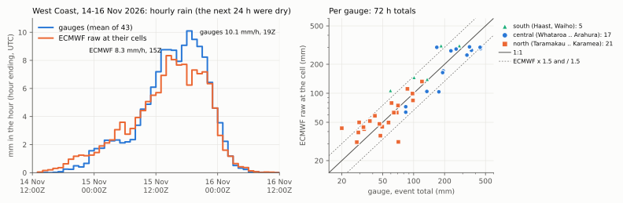

# West Coast storm validation, 14-17 November 2026 (rf-t26.7)

Does gauge scaling (`docs/rainfall-scaling.md`) make ECMWF's rain better for a real West Coast storm?
This report compares ECMWF's observed proxy, raw and scaled, with the regional council gauges, at the
gauges and over 11 catchments, for the largest storm in the gauge cache. A second storm (24-27 October)
is a check. It was made with `rain validate` (code: `src/river_finder/rainfall/validate.py`, tests:
`tests/test_rainfall_validate.py`) on 2026-11-22, with the factor file of 2026-11-22 20:16Z.

## Findings

- **The storm.** 2026-11-14 12:00Z to 11-17 12:00Z (72 h). Rain fell from 14 November 23Z to 16 November
  03Z (28 h with a gauge mean of at least 1 mm/h; 15 November 12:00 to 16 November 16:00 NZDT). At the 43
  usable West Coast gauges: mean 147 mm, median 98 mm, 10 gauges above 200 mm, the most 453.5 mm (Tuke Hut).
  The wettest hour was 52 mm (Tuke Hut, hour ending 15 November 19Z), and the gauge mean peaked at 10.1
  mm/h in the same hour. It is the largest event in the gauge cache by 24 h, 48 h and 72 h totals.
- **Raw ECMWF is close to the gauges in total and wrong in where the rain fell.** Summed over the 43
  gauges, ECMWF at their cells has 94 % of the gauge rain (median per gauge 1.02). Per gauge, the gauge /
  ECMWF ratio goes from 0.46 to 2.27 (RMS of the log ratio 0.33). ECMWF is low in the central Westland
  ranges (Hokitika, Whitcombe, Kokatahi: 1.3-1.5 x ECMWF at the high gauges) and high in the north (Grey,
  Ahaura, Buller, Inangahua) and the south (Haast, Waiho valley floor).
- **The factor in use makes it worse.** The West Coast factor in use is 0.906 (version 1, set by the first
  `rain scale` run with three dead gauges in it). With that factor, ECMWF has 85 % of the gauge rain: bias
  -22 mm per gauge against -9 mm raw, and RMSE 63 mm against 58 mm. The ratio of the current 30-day window
  without the dead gauges is 1.007 (from rf-t26.16). It becomes version 2 at the next daily run. With it,
  the result is the same as raw (RMSE 57 mm). Without the storm's hours, the 30-day ratio is 0.996, so the
  storm moves the factor by about 1 %.
- **One factor per zone cannot do better here.** Even the storm's own ratio (1.062, in sample) gives an
  RMSE of 56 mm and an RMS log of 0.34, which is no improvement on raw. The error is spatial, so a factor
  that applies to the whole West Coast cannot correct it.
- **Catchments show the same thing.** Over 11 catchments, against an inverse-distance interpolation of the
  gauges (IDW), raw ECMWF has 97 % of the gauge-based rain (RMSE 45 mm, RMS log 0.25). The factor in use
  gives 88 % (RMSE 49 mm). The 30-day ratios give the same result as raw. ECMWF has about 70 % of the
  gauge-based total in the Hokitika (216 mm against 282-352 mm) and 125-160 % in the Ahaura, Buller and
  Haast.
- **The timing is good.** For the zone's gauge mean, the hourly correlation is 0.98 at lag 0, the best lag
  is 0 h, and 3-hour sums give r 0.985. ECMWF's rain centroid is 0.9 h early. Its peak is lower and
  broader: 8.3 mm/h at 15Z against the gauges' 10.1 mm/h at 19Z. Per gauge, the median r is 0.88, and 31
  of the 43 gauges have their best lag at 0 or -1 h. On the Haast, ECMWF is 1-5 h early (r 0.55-0.63).
- **The October storm gives the same result.** On 24-27 October, raw ECMWF has 95 % of the gauge rain, and
  the factor in use makes the bias worse (-5 to -15 mm). The 30-day ratio gives the same result as raw.
  The Hokitika is low and the Grey and Ahaura are high again.
- **Canterbury divide, same storm.** Its factor of 1.195 helps: ECMWF goes from 84 % to 101 % of the gauge
  rain, and the RMSE from 52 to 43 mm. Without the storm's hours its factor is 1.198, so this result is
  out of sample in time.
- **IMERG cannot be compared from here.** The NASA hosts are blocked, and IMERG Final for this storm is
  not published until about March 2027. See "IMERG" for what the comparison needs.

What follows from this:

1. Let the West Coast factor move to the 30-day ratio. This happens at the next daily `rain scale` (v2,
   about 1.0). Until then, the 0.906 in use takes about 10 % off every West Coast total.
2. A zone factor does not fix the West Coast's catchment totals. The errors are of the order of ±30-50 %
   by catchment, and their sign depends on the part of the coast. A finer unit could help: a split by
   latitude or by orographic band, checked on a second 30-day window, as for the Tasman inland basins.
   Over the 30 days, the central band's gauges see 1.08 x ECMWF, the north 0.94 and the south 0.91. The
   storm makes this pattern stronger (1.19 / 0.93 / 0.75), and the 30 days show it weaker, so it is a
   candidate and not yet a result.
3. The outage rule does not catch a half-dead gauge. In the October storm, Colliers Creek recorded 2 mm
   while its cell had 203 mm and its neighbours 150-360 mm. The gauge was not dry for 24 hours, so the
   rule did not mark it. A rule that compares event totals with the neighbours would catch this kind of
   failure (proposed follow-up). Tasman's HY Matiri at Lake Outlet (2 mm against 32 mm in its cell) is
   another candidate. *Update 2026-11-25 (rf-t26.20):* the under-read rule (`docs/rainfall-scaling.md`,
   "Under-read events") now marks Colliers Creek in this storm (1 % of its neighbours' median and of
   ECMWF), and `rain validate` applies it: "Second storm" below. Matiri's storm (24-31 mm) is below the
   rule's 50-mm threshold.



*Left: the mean of the 43 gauges and ECMWF at their cells, each hour (hour ending, UTC). The last 24 h of
the 72-hour window were dry and are not shown. Right: each gauge's 72-hour total against raw ECMWF in its
0.1° cell, by band: south of 43.3° S (Haast, Waiho), 42.6-43.3° S (Whataroa to Arahura), north of 42.6° S
(Taramakau to Karamea). The numbers are in the per-gauge table below.*

## The event

Ranking from the gauge cache (`gauges_hourly.npz`, 17 October to 22 November): the mean of the West Coast
gauges with a cell, each hour over the gauges usable in that hour, summed over moving windows:

| window | 1st | 2nd | 3rd | 4th |
|---|---|---|---|---|
| 24 h | **127 mm, to 16 Nov 02Z** | 91 mm, to 26 Oct 17Z | 62 mm, to 2 Nov 18Z | 59 mm, to 11 Nov 17Z |
| 48 h | **138 mm, to 16 Nov 14Z** | 98 mm, to 26 Oct 22Z | 83 mm, to 11 Nov 18Z | 82 mm, to 3 Nov 09Z |
| 72 h | **141 mm, to 17 Nov 22Z** | 121 mm, to 28 Oct 20Z | 97 mm, to 4 Nov 16Z | 89 mm, to 12 Nov 14Z |

The window `--event 2026111412 2026111712` (rain in 14 Nov 12Z .. 17 Nov 12Z) holds the whole storm
with dry hours on either side. The rain fell over the whole coast but was heaviest in central Westland:

| band (gauges) | gauge mean | ECMWF / gauge (storm) | gauge / ECMWF, 30 days (factor window) |
|---|---|---|---|
| south, Haast and Waiho (5) | 152 mm | 1.34 | 0.91 |
| central, Whataroa to Arahura (17) | 256 mm | 0.84 | 1.08 (15 gauges) |
| north, Taramakau to Karamea (21) | 57 mm | 1.07 | 0.94 |

By gauge total, the 10 gauges above 200 mm see ECMWF / gauge = 0.83, the 9 at 100-200 mm 1.12 and the
24 below 100 mm 1.06. ECMWF misses the orographic maximum and spreads the rain onto the lower, drier
gauges. This is the pattern that the Canterbury split found on the other side of the divide.

## Data and method

```bash
uv run river-finder rain validate --event 2026111412 2026111712 --region "West Coast"   # ~30 s once the event store exists
uv run river-finder rain validate --event 2026102412 2026102712                         # the October check
uv run river-finder rain validate --event ... --exclude-gauge "wcrc:Taipo Rv @ SHB"      # sensitivity
uv run river-finder rain validate --event ... --no-underread     # without the under-read rule (rf-t26.20)
```

The step writes `<rain>/validation/validate_<regions>_<START>_<END>.json` (everything) and `.md` (the
tables below). Details are in the module docstring.

- **Gauges** are the scaling's: hours with state good or raw, copies of one station counted once (3 West
  Coast copies dropped), likely outages left out (Colliers Creek, out for the whole storm), at least 80 %
  of the event hours usable. Since rf-t26.20, under-read events are left out too (none in this storm). That gives 43 of the 57 West Coast gauges: 8 have no location, and 3 have no
  usable hours (Colliers Ck, Waipuna, Roaring Billy WCRC). The outages of Kokatahi and Smyth Hut ended on
  13 November, so both gauges are in this storm.
- **ECMWF** is the observed proxy: each hour comes from the newest run that has it, at leads 1-6. At the
  gauge cells it comes from the scaling's cell store, which holds the values the factor was fitted on
  (Open-Meteo for this storm). For the catchments, the whole NZ window was read again into
  `<rain>/validation/ecmwf_grid_2026111400_2026111800.npz`: 64 MB, 2.4 min. Open-Meteo no longer had the
  runs of 14 November, so the first 24 hours (14 Nov 01Z .. 15 Nov 00Z, 4 % of the storm's rain) came
  from ECMWF's GRIB files. At the 189 gauge cells over the storm, the two stores agree to 1.0002, with a
  maximum difference of 1.2 mm in one hour.
- **Factors** per zone:
  - in use: the factor file's 0.906, version 1;
  - window: the ratio of sums over the factor file's window (23 Oct 03Z .. 22 Nov 03Z), recomputed as
    1.007, which is the same as the file;
  - no event: the same window without the 72 storm hours, 0.996, out of sample in time;
  - no event, own gauge out: the no-event ratio without the gauge itself (per gauge);
  - no event, own gauges out: the no-event ratio without the catchment's gauges (per catchment);
  - the event's own ratio, 1.062: in sample, the best that one factor can do.

  All ratios are clamped to [0.5, 2] like the scaling. `max_step` and `min_change` are rules of the
  version history and are not applied.
- **Catchments**: the outlet reach of each river is the reach of that name with the largest area in the
  West Coast. Its ECMWF total is the upstream mean depth, computed like `rain totals` (pixel area x
  local depth summed upstream / upstream pixel area). Scaled totals apply each upstream catchment's zone
  factor (the Buller is 56 % Tasman). The gauge-based estimates are:
  - inside: the mean of the gauges whose 8 m local catchment (`local_catchment_core.tif`) lies upstream;
  - IDW: gauge totals interpolated to the catchment's 0.1° cells, with power 2, the gauges within 30 km
    and at least the 3 nearest, weighted by the catchment's area in each cell. Only gauges of the zones
    upstream are used, so no gauge from the east of the main divide;
  - guided: ECMWF's own pattern times the gauges' local ratio. This is each cell's ECMWF total x the IDW
    of log(gauge / ECMWF) (cells with at least 5 mm, ratios clipped to 0.2-5).

  None of the three is the truth. The gauges are points, and WCRC's network samples the wet ranges on
  purpose: 6 gauges in the Hokitika, 5 of them high. No local DEM is available (the tiles keep no
  elevations), so the estimates do not use elevation. The guided estimate is the nearest thing to it,
  because it follows ECMWF's orography between the gauges.
- **Timing**: per gauge, the hourly Pearson r at lag 0, and the lag k in ±6 h that gives the highest r of
  gauge hour h against ECMWF hour h + k. `k < 0` means ECMWF is early; this is the sign that
  `docs/rain-gauges.md` writes as +k. Also: the r of 3-hour sums (hours ending 03, 06, ... UTC, the GRIB
  steps), the peak hours, and the lag of the rain centroid. For the zone, the mean over the gauges with
  all 72 hours is used. For a catchment, its ECMWF series is compared with the IDW hourly series.
- **Metrics** are computed over the gauges (or catchments), comparing the model total with the gauge
  total:
  - ECMWF / gauge: the ratio of sums;
  - median ratio;
  - bias: the mean difference, in mm;
  - RMSE and MAE, in mm;
  - RMS log: the RMS of log(gauge / ECMWF), the score that chose the zones.

## At the gauges (West Coast, 43 gauges)

| variant | factor | ECMWF / gauge | median ratio | bias (mm) | RMSE (mm) | MAE (mm) | RMS log |
|---|---|---|---|---|---|---|---|
| ECMWF raw | 1 | 0.942 | 1.018 | -8.5 | 57.6 | 38.0 | 0.329 |
| x the factor in use | 0.906 (v1) | 0.853 | 0.923 | -21.6 | 63.4 | 39.9 | 0.338 |
| x the 30-day ratio (in sample) | 1.007 | 0.948 | 1.026 | -7.6 | 57.3 | 38.0 | 0.330 |
| x the 30-day ratio without the storm | 0.996 | 0.938 | 1.015 | -9.0 | 57.7 | 38.1 | 0.329 |
| ... and without the gauge itself | 0.96-1.02 | 0.937 | 1.021 | -9.2 | 59.7 | 38.9 | 0.333 |
| x the storm's own ratio (in sample) | 1.062 | 1.000 | 1.082 | 0.0 | 56.0 | 37.6 | 0.338 |

Per gauge, sorted by total. Band: S south of 43.3° S, C 42.6-43.3° S, N north. ECMWF is at the gauge's
0.1° cell over the same hours. The lag is k < 0 when ECMWF is early.

| gauge | band | gauge mm | ECMWF raw | gauge / ECMWF | x 0.906 (in use) | x 0.996 (no event) | x no event, own gauge out | peak mm/h | r, lag 0 | best lag |
|---|---|---|---|---|---|---|---|---|---|---|
| Tuke Rv @ Tuke Hut | C | 453.5 | 299.9 | 1.51 | 271.6 | 298.8 | 291.4 | 52.0 | 0.85 | -3 |
| Kokatahi Rv @ Above Crawford Junction | C | 447.5 | 290.0 | 1.54 | 262.7 | 289.0 | 289.0 | 29.0 | 0.94 | +0 |
| Cropp Rv @ Waterfall | C | 443.0 | 299.9 | 1.48 | 271.6 | 298.8 | 289.1 | 41.5 | 0.91 | -1 |
| Cropp Rv @ Base OTA | C | 365.0 | 279.3 | 1.31 | 253.0 | 278.3 | 273.3 | 30.0 | 0.92 | -1 |
| Ivory Rv @ Ripplerock | C | 351.0 | 299.9 | 1.17 | 271.6 | 298.8 | 294.8 | 40.0 | 0.85 | -2 |
| Hokitika Rv @ Gorge WCRC | C | 349.5 | 303.0 | 1.15 | 274.4 | 301.9 | 307.4 | 32.0 | 0.96 | +0 |
| Styx Rv @ Mt Browning new | C | 330.0 | 248.9 | 1.33 | 225.5 | 248.1 | 244.0 | 33.0 | 0.91 | +1 |
| Waiho Rv @ Douglas Hut | S | 278.5 | 312.1 | 0.89 | 282.7 | 311.0 | 309.3 | 30.5 | 0.88 | +0 |
| Wanganui Rv @ Above Smyth Hut | C | 259.0 | 287.6 | 0.90 | 260.5 | 286.6 | 286.6 | 25.0 | 0.92 | -1 |
| Whataroa Rv @ SH6 | C | 230.5 | 275.6 | 0.84 | 249.7 | 274.7 | 277.6 | 24.0 | 0.90 | +1 |
| Pigeon Creek CWS | C | 194.2 | 170.6 | 1.14 | 154.5 | 170.0 | 170.9 | 29.6 | 0.86 | +0 |
| Harihari @ School | C | 191.5 | 163.9 | 1.17 | 148.5 | 163.3 | 164.4 | 22.0 | 0.90 | +0 |
| Waiho Rv @ SH6 | S | 185.0 | 312.1 | 0.59 | 282.7 | 311.0 | 315.0 | 22.0 | 0.87 | +0 |
| Butchers Ck @ Butchers Gully | C | 176.0 | 103.5 | 1.70 | 93.8 | 103.2 | 103.4 | 21.5 | 0.88 | +1 |
| Taipo Rv @ SHB | C | 168.0 | 299.9 | 0.56 | 271.6 | 298.8 | 306.2 | 16.0 | 0.80 | -3 |
| Haast Rv @ Cron Ck | S | 135.5 | 139.9 | 0.97 | 126.7 | 139.4 | 138.4 | 14.5 | 0.61 | -1 |
| Ross @ Township | C | 134.5 | 104.4 | 1.29 | 94.6 | 104.1 | 104.6 | 17.5 | 0.84 | +0 |
| Sirdar Ck @ Paparoa | N | 120.5 | 132.4 | 0.91 | 119.9 | 131.9 | 131.7 | 14.0 | 0.88 | -1 |
| Haast Rv @ Roaring Billy | S | 101.0 | 146.3 | 0.69 | 132.5 | 145.8 | 145.6 | 11.0 | 0.55 | -5 |
| Orikaka Rv @ Plateau Stm | N | 98.5 | 84.3 | 1.17 | 76.4 | 84.0 | 84.0 | 20.5 | 0.97 | +0 |
| Kumara @ School | C | 98.5 | 84.6 | 1.16 | 76.6 | 84.3 | 84.4 | 8.0 | 0.82 | +1 |
| Arnold Rv @ Moana WWTP | N | 97.5 | 99.3 | 0.98 | 90.0 | 99.0 | 99.5 | 13.0 | 0.91 | +0 |
| Grey Rv @ Haupiri | N | 87.0 | 111.1 | 0.78 | 100.7 | 110.7 | 111.4 | 12.5 | 0.78 | +0 |
| Hokitika EWS | C | 83.8 | 63.6 | 1.32 | 57.6 | 63.4 | 63.6 | 8.0 | 0.88 | -2 |
| Okarito EWS | C | 83.8 | 72.5 | 1.16 | 65.7 | 72.3 | 72.3 | 7.4 | 0.72 | +1 |
| Karamea Rv @ Garibaldi | N | 71.0 | 31.3 | 2.27 | 28.3 | 31.2 | 31.0 | 15.5 | 0.90 | -1 |
| Grey Rv @ Ngahere | N | 70.5 | 74.6 | 0.94 | 67.6 | 74.3 | 74.8 | 10.0 | 0.96 | +0 |
| Grey Rv @ WCRC Office2 | N | 68.5 | 63.0 | 1.09 | 57.0 | 62.7 | 62.7 | 9.5 | 0.89 | +0 |
| Greymouth Aero EWS | N | 64.2 | 63.0 | 1.02 | 57.0 | 62.7 | 62.8 | 10.2 | 0.80 | +0 |
| Buller Rv @ Bald Hill | N | 61.0 | 79.2 | 0.77 | 71.7 | 78.9 | 79.2 | 16.0 | 0.91 | +0 |
| Haast Rv @ Moa Ck | S | 59.5 | 107.0 | 0.56 | 96.9 | 106.6 | 107.5 | 7.0 | 0.63 | -3 |
| Wangapeka @ Biggs Top | N | 57.0 | 49.7 | 1.15 | 45.0 | 49.6 | 49.4 | 14.0 | 0.94 | +0 |
| Mokihinui Rv @ Stoney Ck | N | 49.5 | 44.9 | 1.10 | 40.7 | 44.8 | 44.6 | 9.5 | 0.94 | -1 |
| Maruia Rv @ Springs Junction | N | 47.5 | 36.3 | 1.31 | 32.9 | 36.2 | 36.2 | 6.5 | 0.78 | +0 |
| Inangahua Rv @ Brunner Range | N | 46.5 | 48.1 | 0.97 | 43.6 | 47.9 | 47.9 | 8.0 | 0.76 | -1 |
| Inangahua Rv @ Landing | N | 42.0 | 58.4 | 0.72 | 52.9 | 58.2 | 58.2 | 8.0 | 0.93 | +0 |
| Grey Rv @ Conical Hill new | N | 37.5 | 51.5 | 0.73 | 46.7 | 51.3 | 51.6 | 7.0 | 0.76 | -2 |
| Westport EWS | N | 33.0 | 42.4 | 0.78 | 38.4 | 42.3 | 42.4 | 8.2 | 0.90 | +0 |
| Reefton @ Township | N | 32.5 | 44.5 | 0.73 | 40.3 | 44.4 | 44.6 | 6.0 | 0.85 | +0 |
| Buller Rv @ Three Channel Flat | N | 29.5 | 49.9 | 0.59 | 45.2 | 49.7 | 48.7 | 5.5 | 0.87 | +0 |
| Mawheraiti Rv @ Atarau Br | N | 29.0 | 39.2 | 0.74 | 35.6 | 39.1 | 39.3 | 4.5 | 0.86 | -1 |
| Karamea Rv @ Township | N | 28.0 | 31.1 | 0.90 | 28.2 | 31.0 | 31.0 | 8.0 | 0.75 | -1 |
| Ahaura Rv @ Gorge WCRC | N | 20.0 | 43.4 | 0.46 | 39.3 | 43.3 | 43.6 | 6.5 | 0.64 | +0 |

**Taipo at SHB** has the coordinates of Tuke Hut, 46 m away (`docs/rainfall-scaling.md`, "Duplicates
and co-located gauges"). Its 168 mm fits the Taramakau (Kumara 98.5 mm, Pigeon Creek 194 mm) better than
the Tuke valley. Without it, ECMWF has 92 % of the gauge rain of the other 42 gauges. The 30-day ratio
becomes 1.033, 1.021 without the storm, and the storm's own ratio becomes 1.089. So this one gauge moves
the West Coast factor by 2.5 %, and its location should be checked with WCRC.

## Catchments

| catchment (outlet gid) | km² | gauges inside | ECMWF raw | x 0.906 (in use) | x no event | x no event, own gauges out | inside mean | IDW | guided |
|---|---|---|---|---|---|---|---|---|---|
| Haast (603005506) | 1 284 | 3 | 133.1 | 120.6 | 132.6 | 132.7 | 98.7 | 98.7 | 91.7 |
| Waiho at SH6 (704004236) | 157 | 2 | 288.8 | 261.6 | 287.7 | 290.0 | 231.8 | 226.1 | 211.5 |
| Whataroa (704000452) | 753 | 1 | 243.1 | 220.2 | 242.2 | 244.8 | 230.5 | 214.0 | 210.1 |
| Wanganui (705003802) | 516 | 2 | 234.4 | 212.3 | 233.6 | 235.1 | 225.2 | 259.3 | 242.2 |
| Hokitika (805002295) | 1 044 | 6 | 216.1 | 195.8 | 215.4 | 203.4 | 351.8 | 311.8 | 282.0 |
| Arahura (805001858) | 286 | 0 | 170.5 | 154.4 | 169.9 | 169.9 | - | 234.3 | 231.0 |
| Taramakau (805000825), area short | 510 of 1 001 | 1 | 160.9 | 145.7 | 160.3 | 160.5 | 98.5 | 195.1 | 198.1 |
| Grey (806004496) | 4 299 | 7 | 84.3 | 76.4 | 84.0 | 87.7 | 76.5 | 77.2 | 73.5 |
| Ahaura (806001170) | 968 | 2 | 86.2 | 78.1 | 85.9 | 87.1 | 53.5 | 60.5 | 62.2 |
| Buller (906002265), area short; 56 % Tasman | 5 880 of 6 314 | 16 | 45.3 | 43.6 | 46.7 | 47.5 | 31.8 | 33.9 | 35.7 |
| Karamea (1007002455) | 1 218 | 3 | 35.0 | 31.7 | 34.9 | 34.5 | 52.0 | 43.1 | 44.3 |

All values are mm over the 72 hours. km² is the upstream pixel area. "Area short" means a tile edge cuts
off part of the catchment (flag `area_short` in `src/river_finder/rainfall/upstream.py`, rf-t26.11). The
totals and estimates then cover only the counted part.

The gauges inside each catchment are:

- Hokitika: Kokatahi 448, Cropp Waterfall 443, Cropp Base 365, Hokitika Gorge 350, Styx Mt Browning
  330, Butchers Gully 176 (Colliers Ck was out);
- Grey: Pigeon Creek 194, Arnold 98, Haupiri 87, Ngahere 70, Conical Hill 38, Mawheraiti 29, Ahaura
  Gorge 20;
- Ahaura: Haupiri 87, Ahaura Gorge 20;
- Haast: Cron Ck 136, Roaring Billy 101, Moa Ck 60;
- Waiho: Douglas Hut 278, SH6 185;
- Wanganui: Smyth Hut 259, Harihari 192;
- Karamea: Garibaldi 71, Biggs Top 57, Township 28;
- Buller: 16 gauges (Orikaka 98 is the most, Matiri 2 the least);
- Taramakau: Kumara 98.5.

| against | variant | ECMWF / gauge | median ratio | bias (mm) | RMSE (mm) | MAE (mm) | RMS log |
|---|---|---|---|---|---|---|---|
| IDW (11) | raw | 0.968 | 1.092 | -5.1 | 44.6 | 36.1 | 0.254 |
| | x 0.906 (in use) | 0.878 | 0.990 | -19.4 | 49.4 | 35.9 | 0.270 |
| | x 0.996 (no event) | 0.965 | 1.088 | -5.5 | 44.7 | 36.2 | 0.257 |
| | x no event, own gauges out | 0.965 | 1.136 | -5.5 | 47.6 | 38.1 | 0.272 |
| | x the storm's own ratio | 1.023 | 1.159 | 3.7 | 44.5 | 35.7 | 0.249 |
| guided (11) | raw | 1.009 | 1.147 | 1.4 | 41.7 | 34.3 | 0.253 |
| | x 0.906 (in use) | 0.916 | 1.039 | -12.9 | 43.6 | 34.0 | 0.258 |
| | x 0.996 (no event) | 1.006 | 1.143 | 1.0 | 41.6 | 34.4 | 0.255 |
| inside mean (10) | raw | 1.053 | 1.174 | 7.7 | 53.5 | 38.2 | 0.338 |
| | x 0.906 (in use) | 0.956 | 1.064 | -6.4 | 54.2 | 33.5 | 0.323 |
| | x 0.996 (no event) | 1.050 | 1.170 | 7.3 | 53.4 | 38.0 | 0.340 |

- The scaled totals differ from raw only by the zone factor: 0.996 without the storm, and 0.94-1.04
  without the catchment's own gauges (1.14 for the Tasman part of the Buller). Meanwhile the ratios of raw
  ECMWF to IDW go from 0.69 (Hokitika) to 1.42 (Ahaura). For the Hokitika, the factor without its own
  six gauges is 0.941 (they are wetter than ECMWF), which takes the total further from them.
- The inside mean is high wherever the gauges stand at the high-rain sites. It scores the factor in use
  best, but only because its 10 % cut offsets that bias, so this estimate is the least reliable of the
  three.
- The Taramakau's single inside gauge (Kumara, on the coastal plain) puts it at 98.5 mm. The IDW and
  guided estimates bring in Pigeon Creek and Mt Browning (195-198 mm). The gauges disagree by 2 x here, so
  this catchment says little.

## Timing

| series | r, lag 0 | best lag (r) | r of 3-hour sums | ECMWF centroid - gauges | peaks: gauges / ECMWF (mm/h, UTC) |
|---|---|---|---|---|---|
| West Coast gauge mean (43) | 0.98 | 0 h (0.98) | 0.985 | -0.9 h | 10.1 at 19Z / 8.3 at 15Z (15 Nov) |
| Hokitika | 0.97 | 0 h | 0.98 | -0.6 h | 24.2 at 19Z / 15.4 at 15Z |
| Whataroa | 0.92 | 0 h | 0.97 | -0.8 h | 20.7 at 18Z / 21.0 at 16Z |
| Grey | 0.97 | 0 h | 0.99 | +0.6 h | 7.8 at 22Z / 8.7 at 22Z |
| Buller | 0.95 | -1 h | 0.96 | -0.9 h | 5.1 at 00Z / 7.4 at 23Z |
| Haast | 0.71 | -3 h | 0.78 | -1.8 h | 8.7 at 14Z / 8.3 at 09Z |

Per gauge, the best lags are: -5 h at 1 gauge, -3 h at 3, -2 h at 3, -1 h at 10, 0 h at 21 and +1 h at
5. The median r at lag 0 is 0.88. ECMWF is in phase with the storm, and its rain arrives about an hour
early. Its peak is flatter: the zone's gauge mean peaks 22 % above ECMWF's peak (10.1 against 8.3
mm/h), and the Hokitika's 57 % above it (24.2 against 15.4 mm/h). In the central catchments, ECMWF's
peak comes up to 4 h before the gauges' heaviest hours (15 Nov 18-20Z). In the south, the front reached
the Haast gauges 1-5 h later than ECMWF had it (the catchment: 3 h). This matches the gauges flagged at
+3/+4 h in the lag check of `docs/rain-gauges.md` (that page writes the sign the other way round).
Hourly r is lower than the r of 3-hour sums: a gauge is a point and a cell is 9 km.

## In sample and out of sample

The factor window (23 Oct 03Z .. 22 Nov 03Z) contains this storm and the October one. Taking the storm
out changes the West Coast ratio from 1.007 to 0.996 (the October storm out: 0.998). Taking each gauge
out as well gives 0.96-1.02 per gauge, and taking each catchment's West Coast gauges out gives
0.94-1.04. None of these changes the picture: with a factor this close to 1, in sample and out of sample give the same
answer. The variant that is clearly worse is the factor in use (0.906), which came from three gauges
that read almost nothing for weeks. It was not overfitting. The outage rule of rf-t26.16 already
corrects it, and this storm confirms that correction.

## Second storm: 24-27 October 2026

`--event 2026102412 2026102712`. At 42 gauges the mean was 108 mm (the most at Cropp Waterfall: 362.5
mm). The gauge mean peaked at 11.1 mm/h at 26 October 12Z, and it was at least 1 mm/h for 26 h
(25 Oct 13Z .. 26 Oct 16Z). ECMWF for this storm is all GRIB (3-hour steps split evenly into hours),
because Open-Meteo has none of these runs any more. Kokatahi and Smyth Hut were in their outage, and
Colliers Ck recorded 2.0 mm against 202.7 mm in its cell. The outage rule did not mark Colliers Ck,
because it was not dry for 24 h. That one gauge takes the RMS log from 0.45 to 0.83, so the numbers below
leave it out (`--exclude-gauge "wcrc:Hokitika Rv @ Colliers Ck"`).

*Update 2026-11-25 (rf-t26.20):* the under-read rule leaves Colliers Ck out by itself (51 of the 72
storm hours marked: 2.5 mm against a neighbour median of 211 mm and 201 mm in ECMWF), so the hand
exclusion is no longer needed. It also marks 29 of Taipo's 72 storm hours (22 mm against 128 mm and 114
mm: see "Under-read events" in `docs/rainfall-scaling.md` for why Taipo is doubtful), so Taipo drops
out of this storm as well. The table below (42 gauges) is `--no-underread --exclude-gauge
"wcrc:Hokitika Rv @ Colliers Ck"`, and `underread_fraction = 0.1` gives the same 42 gauges. The default
(41 gauges, factors of the same window recomputed with the rule):

| 41 gauges | factor | ECMWF / gauge | bias (mm) | RMSE (mm) | RMS log |
|---|---|---|---|---|---|
| raw | 1 | 0.927 | -7.9 | 40.6 | 0.435 |
| x the factor in use | 0.906 | 0.840 | -17.4 | 45.7 | 0.433 |
| x the 30-day ratio without the storm | 1.005 | 0.933 | -7.3 | 40.3 | 0.436 |
| x the storm's own ratio | 1.078 | 1.000 | 0.0 | 38.5 | 0.451 |

The conclusions do not change: raw ECMWF is within 5-7 % of the gauge rain, the factor in use makes it
worse, and the 30-day ratio gives about the same result as raw.

| 42 gauges | factor | ECMWF / gauge | bias (mm) | RMSE (mm) | RMS log |
|---|---|---|---|---|---|
| raw | 1 | 0.953 | -5.1 | 43.5 | 0.445 |
| x the factor in use | 0.906 | 0.863 | -14.8 | 47.3 | 0.440 |
| x the 30-day ratio without the storm | 0.998 | 0.951 | -5.3 | 43.6 | 0.445 |
| x the storm's own ratio | 1.049 | 1.000 | 0.0 | 42.7 | 0.456 |

Catchments against IDW: raw 1.03 (RMSE 19 mm), in use 0.93 (RMSE 22 mm). The Hokitika is again low
(ECMWF 161 mm against IDW 188 and guided 175). The Grey (68.5 against 47-48) and the Ahaura (73 against
40-43) are again high. Timing: r 0.95 at lag 0, best lag 0, 3-hour sums r 0.99, ECMWF's centroid 2.0 h
early.

## The other side of the divide, same storm

`--region "Canterbury divide" Tasman`: the 11 Canterbury divide gauges had a mean of 138 mm (the most at
Clough Memorial, Wilberforce: 331.5 mm).

| 11 gauges | factor | ECMWF / gauge | bias (mm) | RMSE (mm) | RMS log |
|---|---|---|---|---|---|
| raw | 1 | 0.844 | -21.5 | 52.0 | 0.387 |
| x the factor in use | 1.195 | 1.009 | 1.3 | 42.9 | 0.403 |
| x the 30-day ratio without the storm | 1.198 | 1.012 | 1.6 | 42.8 | 0.404 |
| x the same, gauge left out | 1.10-1.25 | 1.007 | 1.0 | 48.2 | 0.432 |

Here the factor corrects a clear bias, and it does so out of sample. The RMS log rises a little,
because the gauges that see less than ECMWF (Clyde 0.50, Cassinia 0.59) move further away. Tasman was
nearly dry (mean 9 mm, below the scaling's 30-mm floor), so this storm says nothing about its factor.

## IMERG

The plan asked for a one-off comparison with IMERG Final for the same storm, to decide whether satellite
rain (rf-t26.2, deferred) is worth adding. It cannot be done from this container, and it cannot be done
for this storm before about March 2027:

- **Hosts.** The proxy refuses every NASA host tried (HTTP 403 on CONNECT, 2026-11-22):
  `gpm1.gesdisc.eosdis.nasa.gov` (GES DISC: `GPM_3IMERGHH.07`, half-hourly, HTTPS and OPeNDAP),
  `urs.earthdata.nasa.gov` (Earthdata Login: every GES DISC download goes through it),
  `arthurhou.pps.eosdis.nasa.gov` and `jsimpsonhttps.pps.eosdis.nasa.gov` (PPS). To allow them, the
  environment's network settings need to change, which this task does not do.
- **Login.** GES DISC needs an Earthdata Login account with the "NASA GESDISC DATA ARCHIVE" application
  approved, used as a bearer token or a `.netrc`. PPS needs its own registration (an e-mail address).
  The key goes in as a network secret for the host, not in the repository.
- **Latency.** IMERG Final V07 comes about 3.5 months after the month it covers, because it is
  calibrated to the GPCC monthly gauge analysis. November 2026 will be out in about early March 2027.
  IMERG Early (about 4 h) and Late (about 14 h) exist now, but they are not gauge-calibrated, and the
  question was whether the calibrated product beats ECMWF.
- **Size.** 144 half-hourly files for 72 h, about 10 MB each globally. An OPeNDAP subset of the NZ
  window is a few MB in all. The comparison itself is cheap: an IMERG cell store for the gauge cells
  (`[scaling.<family>]`, `<family>_cells.npz`, see "Not done here" in `docs/rainfall-scaling.md`), then
  this step with a filler for its grid.
- **What can be done later.** The October storm's IMERG Final (published around February 2027) and
  this storm's (around March) can be compared with exactly this step, once the hosts and a login exist.
  Until then, the ECMWF results above are the baseline it has to beat: 94-95 % of the gauge rain in
  total, RMS log 0.33-0.45 per gauge and 0.25 per catchment, and hourly r 0.95-0.98 for the zone.

## Limits

- Two storms, one region, one model version. Both storms were in the 30-day window of the factor.
- The gauges are points, and the WCRC network leans to the wet ranges and valley floors. The "truth"
  for the catchments is itself an interpolation of 1-16 gauges, and the three estimates differ by up to
  2 x (Taramakau). There is no elevation-aware estimate, because no DEM is kept locally.
- 8 West Coast gauges have no coordinates, among them Colliers Ck 2 (420.5 mm in this storm, probably
  the working Colliers Ck), Mahitahi and Smyth Hut. Taipo's coordinates are doubtful.
- The Taramakau and Buller outlets are cut by tile edges ("area short").
- The first 24 h of the November catchment field (4 % of its rain) and all of October are GRIB hours
  (3-hour steps split evenly). This is tested to agree with Open-Meteo to 1.0002 at the gauge cells for
  this storm, but it smooths hourly timing at the start.
- The gauge cache keeps 60 days. An older storm needs the gauges' history first, from the councils'
  Hilltop servers for WCRC and TDC.
